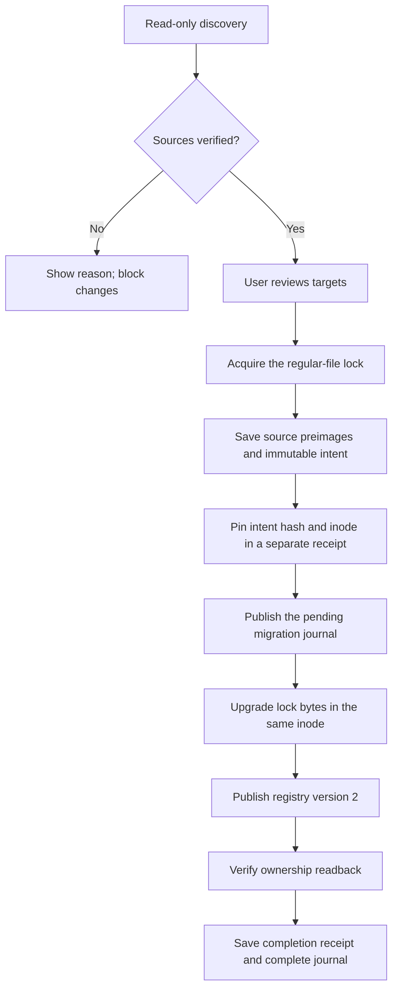

# Lifecycle and ownership checks

The manager changes local files. It does not unload running code, close mod views, quit Herdr, or confirm runtime reload.

## Ownership migration

Discovery is read-only. It returns a migration summary when it can verify either legacy ownership format:

1. PR #5 package records in a version-1 registry.
2. Main-branch Git checkouts with a valid `.git/herdr-mod-manager.json` marker and matching Git source evidence.

Disjoint sources can be combined. Conflicting identities, unsafe metadata, directory locks, and unverified sources block migration. The manager does not convert Git checkouts to packages or delete their Git data.

The user must review the target paths, repositories, and ownership kinds. Confirmation sends the exact summary token. The backend checks the sources again under the exclusive lock.

The version-2 lock remains a regular file. Its inode is not replaced during handover. Older writers that check the version refuse it; they do not gain another lock domain. The saved version-1 data is evidence, not a supported downgrade path.

A pending journal cannot supply new ownership baselines. Its immutable fields must match the separately pinned intent. A complete-phase label also needs the matching completion receipt. Missing or changed evidence blocks changes.

## Commit-time dependencies

Before update or uninstall, the runtime adapter supplies a new snapshot of the current layout and open mod views. It collects the update snapshot after network staging. The backend also reads local configuration again before live writes.

The checks include:

- Current layout mod leaves and configured layout files.
- Shipped-mod bookkeeping and manager/development links.
- Native `mod.open` bindings, including `args.name` and `mod.open:<id>`.
- Native `<mod>:<command>` bindings, including dotted folder IDs.
- Known custom dot-form command bindings and configured mod roles.

Descriptions, theme strings, and unrelated text are not mod references. Missing runtime evidence, unreadable configuration, and ambiguous configuration block update and uninstall. The manager does not guess that a dependency is absent.

A runtime snapshot is not a runtime lock. Do not edit the target, open another copy, or quit Herdr during an operation. The backend checks available evidence again, but it cannot prove that all previously loaded code has stopped.

## Live file publication

Each mutation uses a per-profile exclusive lock and verifies root, directory, file, source, and ownership identities. New files use complete private staging and no-overwrite publication. Existing files are moved to retained storage and checked before replacement. A conflict does not authorize deletion or adoption of the conflicting object.

Metadata publication carries the original hash and inode through the same move, verify, and exclusive-publication boundary. A later registry edit is not silently overwritten. Metadata preimages remain outside `mods`.

### Preserved Git checkouts

Git writes only inside private staging. Live apply does not run `git merge`, `git update-ref`, or `git index-pack` against the installed checkout.

The backend publishes receipt-pinned pack, pack-index, ref, and index data through no-follow directory descriptors. It uses native Git lock files, checks the old loose or packed ref, and publishes the checked ref before working-tree files. Missing metadata parents are created privately and published exclusively. Existing index and loose-ref modes are retained.

The checkout root, `.git` directory, existing local refs, objects, and reflogs remain. Updates do not append a reflog entry. Commit history remains available through Git; transaction evidence records the manager's file transition.

Git uninstall moves the complete verified checkout to the archive path shown in confirmation. It does not erase local branches, objects, or history.

## Failure and recovery

A verified rollback restores only operation-owned state. Unexpected files, metadata, refs, locks, or directory identities stop rollback and remain available for inspection. The UI then reports failure, refreshes actual discovery, and does not claim runtime success.

Keep the transaction journal, immutable intent, receipts, original-file manifest, metadata preimages, and workspace backups together. Do not delete a journal, replace the lock, create an empty registry, or copy old metadata over current files to bypass a blocked state. Compare the recorded identities with current files before a maintainer performs recovery.

These checks reduce file-operation risk. They are not an OS sandbox and do not make installed JavaScript trustworthy.
