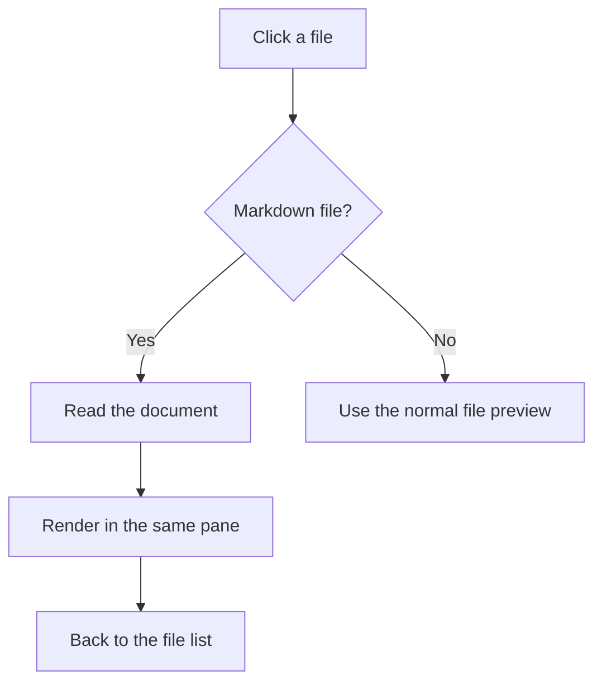
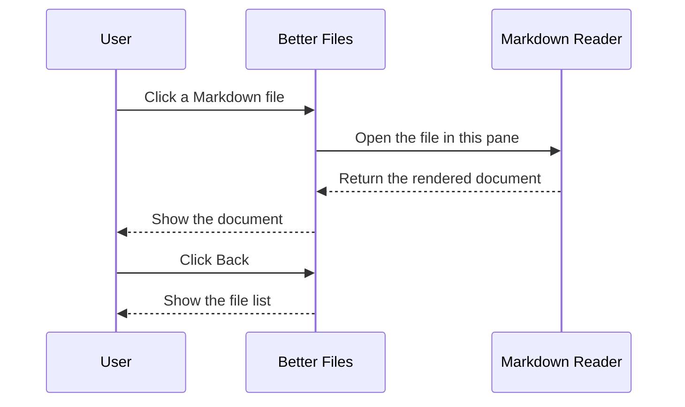
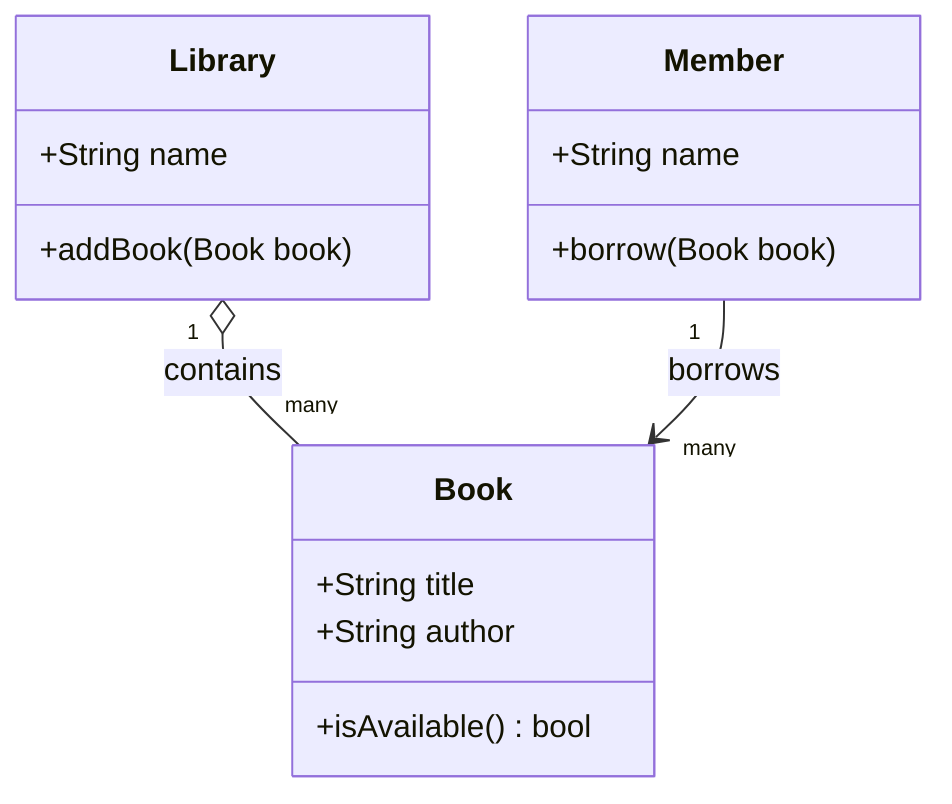
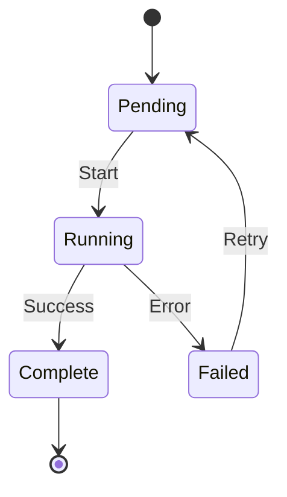
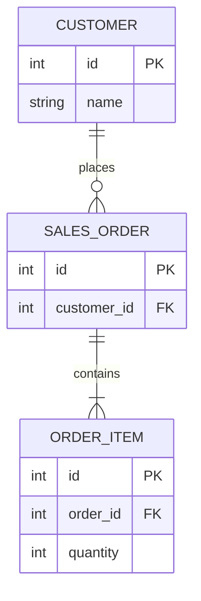

# Markdown rendering examples

These examples were used to test the removed Better Files mod. Open this
document in a Markdown renderer to compare each example with its expected
output. Renderer support varies.

All chart data is in this file. No external data source is required.
Code blocks are examples only. Do not execute them.

## Contents

- [Basic Markdown](#basic-markdown)
- [Mermaid diagrams](#mermaid-diagrams)
- [LaTeX equations](#latex-equations)
- [Code blocks](#code-blocks)
- [Vega-Lite charts](#vega-lite-charts)
- [Visual checklist](#visual-checklist)

## Basic Markdown

Expected: headings, **bold text**, _italic text_, ~~deleted text~~, and
`inline code` use distinct styles.

> Expected: this paragraph appears as a block quote, not as a line with a leading
> `>` character.

| Content          | Expected result                          |
| ---------------- | ---------------------------------------- |
| Mermaid          | A diagram, not Mermaid source            |
| LaTeX            | A typeset equation, not LaTeX source     |
| Python, Go, Rust | Readable code with preserved indentation |
| Vega-Lite        | A chart, not JSON source                 |

- A parent list item
  - A nested list item
- A second parent item

- [x] Example of a completed task
- [ ] Example of an incomplete task

## Mermaid diagrams

### Flowchart

Expected: a decision diamond with separate Markdown and other-file paths.



### Sequence diagram

Expected: three participants, request arrows, and dashed response arrows.



### Class diagram

Expected: three class boxes with properties, methods, and relationship labels.



### State diagram

Expected: start and end markers, a retry loop, and four named states.



### Entity relationship diagram

Expected: customer, order, and order item entities with cardinality markers.



## LaTeX equations

These examples use display math. Inline math is not part of this check.

### Quadratic formula

Expected: a fraction, a plus-or-minus sign, a square root, and superscripts.

$$
x = \frac{-b \pm \sqrt{b^2 - 4ac}}{2a}
$$

### Gaussian integral

Expected: an integral with infinite limits and a square root on the right.

$$
\int_{-\infty}^{\infty} e^{-x^2}\,dx = \sqrt{\pi}
$$

### Aligned equations

Expected: two rows with aligned equals signs, summation limits, and a fraction.

$$
\begin{aligned}
S_n &= \sum_{k=1}^{n} k \\
&= \frac{n(n+1)}{2}
\end{aligned}
$$

### Matrix multiplication

Expected: a two-by-two matrix, a column vector, and a two-row result vector.

$$
\begin{bmatrix}
1 & 2 \\
3 & 4
\end{bmatrix}
\begin{bmatrix}
x \\
y
\end{bmatrix}
= \begin{bmatrix}
x + 2y \\
3x + 4y
\end{bmatrix}
$$

## Code blocks

Expected: all three blocks preserve line breaks, indentation, and punctuation.
Each program finds `7` at index `3` and prints `3` when run outside the reader.

### Python

```python
def binary_search(values: list[int], target: int) -> int:
    low, high = 0, len(values)
    while low < high:
        mid = low + (high - low) // 2
        if values[mid] < target:
            low = mid + 1
        elif values[mid] > target:
            high = mid
        else:
            return mid
    return -1


if __name__ == "__main__":
    print(binary_search([1, 3, 5, 7, 9], 7))
```

### Go

```go
package main

import "fmt"

func binarySearch(values []int, target int) int {
    low, high := 0, len(values)
    for low < high {
        mid := low + (high-low)/2
        if values[mid] < target {
            low = mid + 1
        } else if values[mid] > target {
            high = mid
        } else {
            return mid
        }
    }
    return -1
}

func main() {
    fmt.Println(binarySearch([]int{1, 3, 5, 7, 9}, 7))
}
```

### Rust

```rust
fn binary_search(values: &[i32], target: i32) -> Option<usize> {
    let (mut low, mut high) = (0, values.len());
    while low < high {
        let mid = low + (high - low) / 2;
        if values[mid] < target {
            low = mid + 1;
        } else if values[mid] > target {
            high = mid;
        } else {
            return Some(mid);
        }
    }
    None
}

fn main() {
    let values = [1, 3, 5, 7, 9];
    if let Some(index) = binary_search(&values, 7) {
        println!("{index}");
    }
}
```

## Vega-Lite charts

These are static charts with inline data. No hover controls are required.

### Bar chart

Expected: four bars labeled A through D. B is the tallest; C is the shortest.

```vega-lite
{
  "title": "Items by category",
  "height": 220,
  "data": {
    "values": [
      {"category": "A", "count": 8},
      {"category": "B", "count": 15},
      {"category": "C", "count": 5},
      {"category": "D", "count": 11}
    ]
  },
  "mark": "bar",
  "encoding": {
    "x": {"field": "category", "type": "nominal", "title": "Category"},
    "y": {"field": "count", "type": "quantitative", "title": "Count"}
  }
}
```

### Line chart

Expected: one line across six days. It dips on day 3 and reaches its peak on day 6.

```vega-lite
{
  "title": "Completed tasks",
  "height": 220,
  "data": {
    "values": [
      {"day": 1, "tasks": 3},
      {"day": 2, "tasks": 7},
      {"day": 3, "tasks": 5},
      {"day": 4, "tasks": 10},
      {"day": 5, "tasks": 12},
      {"day": 6, "tasks": 16}
    ]
  },
  "mark": "line",
  "encoding": {
    "x": {"field": "day", "type": "quantitative", "title": "Day"},
    "y": {"field": "tasks", "type": "quantitative", "title": "Tasks"}
  }
}
```

### Scatter plot

Expected: eight circles in two colors, with a legend for groups A and B.

```vega-lite
{
  "title": "Study time and score",
  "height": 220,
  "data": {
    "values": [
      {"hours": 1, "score": 52, "group": "A"},
      {"hours": 2, "score": 61, "group": "A"},
      {"hours": 3, "score": 69, "group": "A"},
      {"hours": 4, "score": 81, "group": "A"},
      {"hours": 1.5, "score": 57, "group": "B"},
      {"hours": 2.5, "score": 65, "group": "B"},
      {"hours": 3.5, "score": 76, "group": "B"},
      {"hours": 4.5, "score": 88, "group": "B"}
    ]
  },
  "mark": "circle",
  "encoding": {
    "x": {"field": "hours", "type": "quantitative", "title": "Hours"},
    "y": {"field": "score", "type": "quantitative", "title": "Score"},
    "color": {"field": "group", "type": "nominal", "title": "Group"}
  }
}
```

## Visual checklist

- [ ] Clicking the file opens it in the same Better Files pane, without a setup form.
- [ ] All five Mermaid diagrams appear as diagrams, without error messages.
- [ ] All four LaTeX blocks appear as equations, without raw LaTeX commands.
- [ ] Python, Go, and Rust code retain their indentation.
- [ ] All three Vega-Lite charts have readable titles, axes, and labels.
- [ ] Scrolling reaches this checklist without missing content.
- [ ] After you make the pane narrower, the content is still readable.
- [ ] **Back** returns to the file list.
