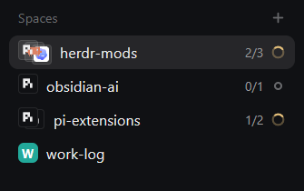

# Agent Spaces

Add agent activity to the Spaces sidebar. Agent icons overlap on the left.
A working/total count and one status ring sit on the right.
For example, `2/3` means that two of three reported agents are working.



This recipe is the build brief. The adjacent files are one implementation.

## What you see

- Keep the Spaces heading, new-space button, selected row, and scrollable list.
- Expanded top-level rows are 30 px high; worktree rows are 28 px high.
- Replace a space's colored avatar with up to three overlapping 18 px tiles.
  - Use each agent's program icon, including repeated icons for separate agents.
  - Offset successive tiles by 6 px horizontally and 2 px vertically.
  - Show `+N` beside the stack for remaining agents.
  - Without an icon, use the first letter of the program name or agent app.
- Keep the space name and optional Git details in the flexible middle section.
  - Truncate text before the fixed activity summary at the right edge.
  - Below a 240 px sidebar width, hide optional Git details on agent rows to keep names and counts readable.
- Put an 11 px working/total count and a 12 px animated ring at the right.
  - A working agent uses the theme's working color and native 900 ms rotation.
  - With no working agents, use a static outlined ring.
  - The static ring uses blocked, done, or idle color, in that order.
- Spaces without reported agents keep the shipped avatar and show no count.
- Keep the shipped compact number rail below a 160 px sidebar width.
- Use native theme colors. Hover the stack or summary to see all reported agents and their states.

## How it behaves

1. Read `agents()` once on each render and group by the full `space` ID.
   - Remote IDs include their machine prefix. Do not group by display name.
   - Count a terminal address once, even if repeated in the snapshot.
   - Count only `status === "working"` in the numerator.
   - Include idle, blocked, and done agents in the denominator.
2. Use the live host snapshot for additions, exits, status changes, and theme changes.
   - Do not poll for agent state or animate with redraw timers.
   - Keep the host's stable agent order; do not sort by activity.
3. Preserve the shipped Spaces operations.
   - Press and release a row to select it.
   - Right-click opens the shipped space menu.
   - Drag reorders spaces within the same machine.
   - Keep Git details, worktree nesting, machine headings, folding, reconnect guidance, new-space controls, and active-row reveal.
4. These summaries do not start, stop, focus, or send input to agents.
   - The separate Agents block remains unchanged.
   - Missing agent reports produce no summary, not an inferred idle state.

## Built from

- One mod root: `mods/agent-spaces/`, containing `main.js`, `activity.js`, `mod.json`, `icons/`, and this recipe.
- Manifest: title `Agent Spaces`, `place: "none"`, cloned from `spaces` in Herdr App 0.1.16.
- Runtime: Herdr's `gpui-kit`, `gpui-base`, and `herdr` modules. No runtime npm packages or companion mods are required.
- Data: `agents()`, `spaces()`, `panes()`, `machines()`, `layout()`, and `theme()`.
- Program icons: use `svg(program.icon)` when `program.tint` is true, otherwise `image(program.icon)`. These paths come from the host program table.
- Preserve the cloned Git/machine support: `exec`, `hc`, `watchFolder`, `run`, `openOverlay`, `shared`, and `setShared`.
- Bundle the clone's chrome icons locally. Retain the Apache, Lucide, and Feather notices.
- Development: Node.js 26, npm workspaces, Vitest, TypeScript, and Biome.

Install only this mod directory in the existing profile's `mods/agent-spaces/`.
Stop Herdr before changing directory links. In an existing personal layout,
change only the Spaces block's `content.mod` from `spaces` to `agent-spaces`.
Keep other layout blocks, installed mods, and keys. This bundle contains no
layout or keybinding file. No new keybinding is required.

To revert, change that block back to `spaces`. The shipped mod is not modified.
Compatibility with Herdr versions other than the installed 0.1.16 is unknown.

## Watch out

- This is trusted JavaScript running with Herdr's permissions.
- The cloned Spaces support runs read-only Git commands and `hc machine ls`.
  Explicit reconnect runs `hc machine rm` and `hc machine add`.
- Local Git directories are watched. Remote Git reads use the space's machine.
  There is no new network request or agent command for activity.
- Shared space colors remain in `space.colors`. Machine folds and reconnect state
  use this mod's local storage; they are not migrated from the shipped Spaces mod.
- Only agents present in `agents()` are counted. Unreported processes and sub-agents
  absent from that API are not discovered or included.
- When some agents work and others need attention, the ring still shows working.
  The count and tooltip retain the other agents. The separate Agents list remains
  the detailed attention view.
- Existing profile links and layouts are not changed by tests.
- Generated SDK declarations and verification evidence must not be shared.

## Done when

Run from the repository root:

```sh
npm test --workspace herdr-agent-spaces
npm run check:mod --workspace herdr-agent-spaces
npm run check:types --workspace herdr-agent-spaces
npm run ci
git diff --check
```

The native view check uses disposable fixture copies. It does not test physical input.

Required results:

- Three reported agents with two working show three overlapping icons and `2/3`.
- All idle shows `0/N` and no rotating ring. Blocked and done also stay out of the numerator.
- A fourth agent adds `+1`; exiting agents update both the stack and total.
- Equal local/remote space names do not share counts.
- Empty spaces have no summary. Missing program icons have a readable initial.
- At 160 px, with long names, many agents, and worktree indentation, the summary stays visible and names truncate.
- The compact rail, machine groups, selection, context menu, drag order, active-row reveal, and new-space control still work.
- Dark and light native screenshots are inspected, with no clipping or unreadable content.
- A disposable-profile live agent transitions between working and idle without reload.
- Normal terminal typing and existing keys remain unchanged.

Completed locally with Herdr App 0.1.16 on Windows:

- 67 model and single-use builder tests pass, including selection, menus, drag restrictions, and machine groups.
- The mod and 13 native fixture states pass `herdr-app check`.
- Nineteen current native screenshots were opened and inspected, including graphite, paper, 160 px width, icon overflow, and worktrees.
- The adjacent preview is a crop of the inspected mixed-agent native capture. It is not a design mockup.

Still required before completion or sharing:

- In a disposable profile with real agents, verify live working/idle transitions, agent exits, and agent additions without reload.
- The profile owner must check physical row selection, context menus, same-machine dragging, hover tooltips, new-space controls, and unchanged terminal input and keys.
- Other platforms and Herdr versions remain unverified.

This bundle remains incomplete until these checks pass. GitHub publication requires separate approval.
