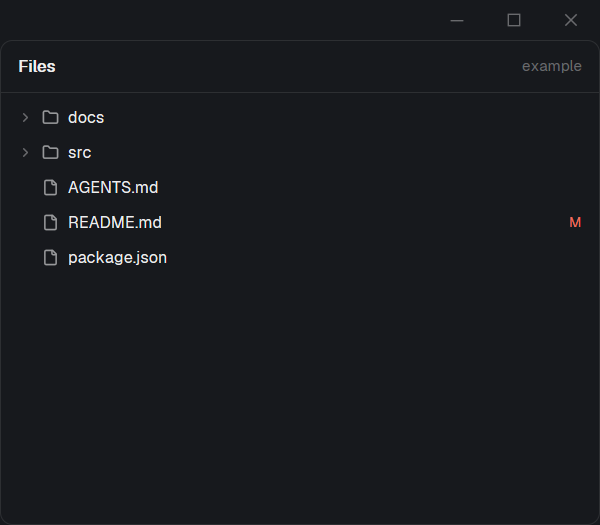

# Better Files

Build a native file browser that reads local Markdown inside the same Files pane. Keep native text/code and generate local SVG for display math, official Mermaid.js, and static Vega-Lite. This recipe is the build brief; the adjacent files are one implementation based on Herdr App 0.1.15 Files.

**Sharing status: incomplete. External acceptance remains open.** The preserved 600 × 525 preview is a genuine native Windows safe file-list fixture, not merged-reader or physical interaction proof. Linux automated and Windows native checks pass. Existing Windows checkout/test limits, merged appearance captures, and owner physical checks remain open.

## What you see

- A pane sized by the existing layout, with native theme colors, a 42 px Files header, 28 px rows, folder/file icons, indentation, and Git marks.
- Loading, empty, error, scrollable-tree, and read-only text-preview states.
- After a Markdown click, a reader inside the Files body. Keep the Files Back arrow. Its 44 px reader header shows the document path, Reload, and Source/Read; there is no Open control or file/root form.
- Selectable 16 px prose, GFM tables/lists/quotes, read-only task marks, compiled footnotes, 18 px content padding, and 14 px block gaps.
- Native read-only syntax-highlighted code and full-document Source. Graphic cards have Copy source, Source/Render, Fit, and zoom controls. Graphic errors retain their source and do not hide other blocks.
- Light/dark assets and a warning for inline TeX. No new tab, split, overlay, or separate reader layout block.

## How it behaves

- Read the focused pane's directory and active space. Watch local folders and refresh every 10 seconds. Hide `.git`, sort directories first, and bound the tree to 500 entries per folder, 5,000 total, and depth 40.
- Match `.md` and `.markdown` without regard to case. Capture each row's directory, root, space ID, and machine identity when building it; never re-read focus to retarget its click.
  - Use the space root only if it contains the browsed directory; otherwise use the browsed directory. Build the absolute file from the captured directory and relative row path.
  - Reject missing/invalid context. Preserve remote identity and reject remote Markdown before local document reads. Never fall back to a matching local file or text preview.
- Mount a retained embedded reader with `cx.new` and `{ file, root, on }`. Open directly; failure shows an error, not setup controls. The standalone reader Open/dialog/tab API and Files-clone preparation tool are retired.
- Canonicalize file/root and local resources, reject outside-root paths and escaping symlinks, then read bounded regular UTF-8 Markdown. Parse an AST with GFM/math extensions, not regular-expression document splitting.
- Compile safe native text/footnotes; prepare native editor states outside render. Complete single-use UI builders before attaching them. Do not rasterize the whole document or embed a browser in the app.
- Send a bounded request file to the local Node helper through `exec` argument arrays. Return a bounded JSON manifest. MathJax produces display SVG; official Mermaid.js uses one sandboxed Chromium browser per batch; Vega-Lite uses a bounded worker. Sanitize generated SVG and check bytes/dimensions/pixel area before display.
- Local Markdown links replace the session inside this reader, after old-session cleanup. Keep the same root and machine identity. Apply the initial fragment once after successful load; empty fragments go to the start. Same-document fragments only scroll. HTTP(S)/mailto links use the system handler only after an explicit click.
- Watch before the first read; debounce by 250 ms. Retry every 10 seconds on Linux, after watch failure, before initial success, or while local images/links remain unresolved. Keep missing links inactive until validated. A failed refresh keeps the last good document and outer scroll handle. Reuse unchanged editor states; release changed/removed states outside render.
- The Back arrow, Escape, or unmodified Backspace returns to the file list, not document history or a different folder root. Use the parent retained async context for keyboard return. An old reader cannot dismiss its replacement. Another file, workspace change, or parent close initiates old-reader cleanup before entity release; parent close waits for pending cleanup.
- Cancel obsolete work and discard stale results. Close owned workers/browsers. Renew active asset leases, wait for renewal before release, and remove partial leases after helper failure. Do not delay replacement display for retired-lease cleanup.
- Other extensions keep the original read-only Editor preview and folders keep their expansion behavior. Opening documents must not write source Markdown, layouts, shared state, or keybindings.

## Built from

- One installable root: `mods/better-files/`, with `mod.json`, `main.js`, `markdown.js`, four SVG icons, `reader/`, `package.json`, this recipe, `preview.png`, fixtures, tests, scripts, and documentation. Keep all runtime imports/assets within this root. No companion mod is required.
- Manifest: `place: "none"`, `focusable: true`, and Files 0.1.15 clone provenance. The Files-derived source retains [Apache-2.0](LICENSE) and [NOTICE](NOTICE); icons retain [their notices](THIRD-PARTY-NOTICES). All reader UI/backend source stays under `reader/` with its [MIT license](reader/LICENSE). Retain [DEPENDENCIES.md](DEPENDENCIES.md); do not relabel dependency/browser licenses as mod source.
- Herdr APIs: `spaces`, `panes`, `focused`, `exec`, `readTextFile`, `watchFolder`, `theme`, `settings`, and `window`. Use `View`, retained `cx.new` children, native element builders, `TextView.html`, `EditorState`/`Editor`, `ScrollHandle`/`Scrollbar`, focus handles, timers, and clipboard handlers from the installed SDK.
- Node.js >=26 and pinned unified/remark/HAST, image-size, XML parser, MathJax, Mermaid.js 12.3.0, Puppeteer, Vega, and Vega-Lite dependencies. Keep exact package pins and the KaTeX 0.19.1 override. See the package and dependency notices for the full versions.
- Helper: `<app-home>/mods/better-files/reader/helper.mjs`. Node's `import.meta.main` supports the helper CLI through copied directories, junctions, and symlinks. On Windows only, if inherited PATH cannot find Node, discover installed Node.js 26+ through persistent PATH or `fnm`; cache its absolute executable without changing persistent environment settings.
- Generated requests/assets/renders/leases use only `<app-home>/data/better-files/`. No migration or automatic access/deletion of `data/markdown-reader/` is allowed.
- Repository setup: root `npm ci`, then `npm run setup:browser --workspace herdr-better-files`. Standalone setup: inside this mod root, `npm install --omit=dev`, then `npm run setup:browser`. Browser setup is explicit, never part of document open.
- Owner installation: close old reader views/helpers and stop Herdr; remove the stale installed `mods/markdown-reader` link and obsolete layout references. Install this root as `<app-home>/mods/better-files`, then change only the intended existing Files block's `content.mod` to `better-files`. Keep its ID, sizes, props, and stack state. Do not overwrite shipped Files, distribute a layout/profile, or change keybindings. No `keys.json` is needed; Escape and unmodified Backspace are local to the reader.
- Herdr App 0.1.15 on Windows passed the merged entry, seven Files fixtures, and nine reader fixtures. Other app versions are unknown. Historical standalone macOS captures are not merged-runtime evidence.

To rebuild from an empty folder:

1. Create the manifest and native bounded file tree above. Implement captured click-context validation separately from file enumeration.
2. Build the embedded reader view, content/session model, and host I/O under `reader/`. Mount it in the Files body and implement ordered close/release and in-view link replacement before adding graphics.
3. Add a local request-file helper, canonical bounded file reads, AST-to-native blocks, safe link registration, and sanitized raster/SVG assets. Use public dependency APIs; do not copy Morsel's AGPL source.
4. Add bounded MathJax/Mermaid/Vega adapters, immutable hashed assets, validated cache reuse, active leases, cancellation, and deadlines. Use native themes and the stated bounds rather than browser-identical pixels.
5. Add routing, security, lifecycle, fixture, and real-browser tests below. Check against the installed SDK and actual native captures. Customize presentation only within the resource/security contract.

## Watch out

- Mods are trusted code. Listing runs local/remote `sh` or PowerShell and read-only Git. Reading starts local Node and, for Mermaid, sandboxed Chromium. Source files are read-only.
- No authored HTML/JavaScript, code fence, or document-controlled shell command runs. Deny automatic authored network resources. Block Mermaid requests before rendering, deny Vega resource loaders, use fixed TeX packages, and sanitize generated SVG. Never disable Chromium's sandbox to make a check pass.
- Relative local PNG/JPEG/GIF/WebP images and Markdown links must stay inside the canonical root. Remote images, authored SVG, `file:` links, and data URLs are disabled. Images are separate blocks, not inline text assets.
- Use an owner-controlled stable workspace. Path/identity checks are not OS isolation against a hostile concurrent directory writer.
- **Inline math is unavailable** on the checked app. Keep visible TeX and a warning; display math does not establish inline or full LaTeX support.
- Vega-Lite is a static bounded subset: selected transforms and layer/concat/facet/repeat, at most 5,000 inline rows, 16 leaf views, and 20,000 row-views. Reject generators, lookups, image/href output, parameters, regex/data-access expressions, and string addition. No interactive controls/tooltips or animation.
- Preserve limits: 1 MiB Markdown; 12,000 AST nodes; depth 40; 600 native blocks; 40 graphics; 4 MiB images/assets; 2 MiB generated SVG; 16 million pixels per graphic and 64 million per document. Work deadlines are 8 seconds per renderer, 70 seconds per helper batch, and 90 seconds per host command.
- Cache: 64 MiB assets and 512 render metadata entries. Leases renew every 10 seconds and expire after 60 seconds; stale jobs/temporary assets are collected after two minutes. A cache full of active assets errors, rather than deleting displayed content.
- Requests contain absolute private paths. Never publish generated data, installed dependencies/browser binaries, SDK declarations, credentials, or a profile. App quit has a 250 ms cleanup budget; forced termination relies on deadlines/expiry, not guaranteed immediate cleanup.
- Only the owner may clear stale `data/markdown-reader/`, after closing old views/helper processes. The agent does not access or delete it. Never delete source Markdown. To disable Better Files, restore `content.mod: "files"`; close readers/helpers and stop the app before removing only its owned link/cache.

## Done when

- **Recorded checks:** the existing native safe file-list PNG is preserved and inspected. Linux merged unit, type, bundle/import/asset/license/recipe, and formatting checks pass; real Chromium checks pass on Linux and Windows. The matching Windows native entry, seven Files fixtures, and nine reader fixtures pass. Standalone installation and helper-link rendering/cancellation use the merged path and only `data/better-files/`. Namespace tests leave old data untouched. No companion import or runnable standalone Open/tab route remains. Exact counts and baseline limits are in [verification.md](docs/verification.md#post-merge-validation).
- **Remaining automated limits:** raw source-checkout CRLF checks, the Windows shared bundle-checker path issue, and Windows-specific full-suite failures remain recorded, not waived. Use the supported clean LF validation environment and resolve Windows portability before claiming a clean Windows gate.
- Routing tests cover case-insensitive extensions, Windows/POSIX paths, nested spaces/Unicode, captured context, unrelated space roots, remote identity, invalid context, and unchanged folder/other-file behavior.
- Tests cover canonical containment/symlinks, malformed/oversized/binary/changed input, unsafe resources, SVG budgets, timeout/cancel, stale results, lease renewal/release, and helper/browser/worker cleanup. Missing resources can recover; failed refresh retains the last good content.
- Native fixture checks cover tree/text/errors, embedded direct open, remote rejection, Back, reader source/graphics/loading/failure, and missing-entry failure without Open controls. Fixed-state descriptions are not physical input tests.
- **Pending owner physical acceptance:** click local and uppercase Markdown with spaces/Unicode; verify in-place open, local links/fragments, Back/Escape/Backspace, scrolling, selection/copy, Source/Read, graphic controls, watch/reload recovery, remote rejection, close/cancel, and unchanged normal app use. Source documents and unrelated layout/key state remain unchanged.
- A disposable matching-app run and inspection establish merged native appearance. The existing file-list preview is not this evidence. The macOS capture script is not a Windows capture tool.
- Keep sharing incomplete until all required checks and [owner acceptance](docs/verification.md#owner-physical-acceptance) pass. Publication requires separate explicit approval; neither a gallery listing nor publication is claimed.
