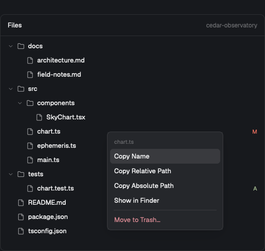

# Files Context

Use the right mouse button on a file or folder in Herdr's Files panel. Copy its
name, relative path, or absolute path. On local macOS, you can also show the item
in Finder or move it to the Trash after confirmation. Left-click still opens a
text preview or expands a folder.



## Install with a coding agent

```text
Read ~/.config/herdr-app/AGENTS.md, then add this mod: https://github.com/narumiruna/herdr-mods/tree/main/mods/files-context
```

Review the bundle before installation. Use a personal layout. Keep the shipped
Files mod and existing keybindings unchanged.

## Install in Herdr

No build or runtime npm packages are required. With Herdr stopped, copy or link
this directory to `~/.config/herdr-app/mods/files-context/`. In a personal
layout, set the Files block's `content.mod` to `files-context`. The repository's
`layouts/workbench.json` already uses it. Reopen Herdr, show the Files panel,
and right-click a row.

To revert, set that block's `content.mod` back to `files`. No new keybinding
is required.

See the [recipe](RECIPE.md) for requirements and validation.
