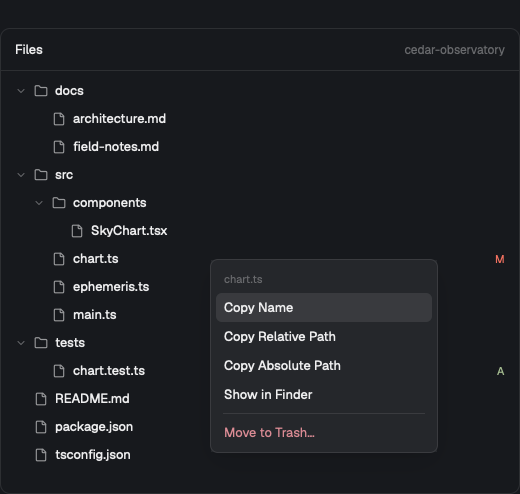

# Files Panel

Browse the focused pane's files and folders, see Git status marks, and open
read-only text previews in Herdr. Left-click to expand a folder or preview a file.

Right-click a file or folder to copy its name, relative path, or absolute path.
On local macOS, you can also show the item in Finder or move it to the Trash
after confirmation.



## Install with a coding agent

```text
Read ~/.config/herdr-app/AGENTS.md, then add this mod: https://github.com/narumiruna/herdr-mods/tree/main/mods/files-panel
```

Review the bundle before installation. Use a personal layout. Keep the shipped
Files mod and existing keybindings unchanged.

## Install in Herdr

No build or runtime npm packages are required. With Herdr stopped, copy or link
this directory to `~/.config/herdr-app/mods/files-panel/`. In a personal
layout, set the Files block's `content.mod` to `files-panel`. The repository's
`layouts/narumi.json` already uses it. Reopen Herdr and show the Files panel.

To revert, set that block's `content.mod` back to `files`. No new keybinding
is required.

See the [recipe](RECIPE.md) for requirements and validation.
