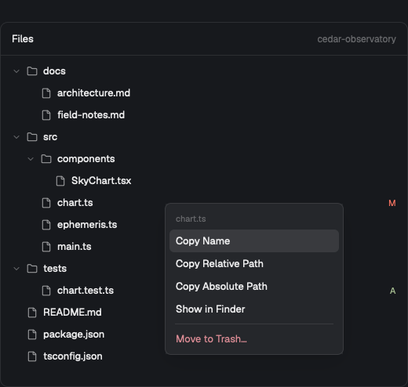

# Files Panel

Build a Files panel for Herdr that browses the focused pane's folders, shows Git
status, and previews text files. Add a menu for copying paths and for Finder
and Trash actions on local macOS. This recipe is the build brief. The adjacent
files are one implementation.



## What you see

- Use the Files block in a personal layout. Keep the Files title, 28 px tree
  rows, file and folder icons, Git status marks, and read-only previews.
- Show a 228 px wide popup at the pointer. Put the item name above the menu.
  Use the theme's popup, hover, selected, and text colors.
- Put the three copy actions first. For local macOS items, add **Show in
  Finder**. Put **Move to Trash…** below a divider in the warning color.
- Show a 410 × 176 px confirmation dialog with the full path, **Cancel**, and
  **Move to Trash**.

## How it behaves

1. Read the focused pane's folder and machine, with the active space as a
   fallback. Browse folders on demand and exclude `.git`.
2. Right-click a tree row to open the menu. Capture the root, relative path,
   and machine from that row. Do not change the selection or preview.
3. **Copy Name**, **Copy Relative Path**, and **Copy Absolute Path** write plain
   text to the local clipboard and close the popup. The relative path is from
   the root shown in the Files panel. The arrow keys select a menu item,
   Enter runs it, and Escape closes the popup.
4. On local macOS, **Show in Finder** reveals the specified item. On remote
   machines and other local platforms, only the copy actions appear.
5. **Move to Trash…** opens confirmation without moving the item. **Cancel**
   or Escape dismisses it. An explicit **Move to Trash** click runs the
   operation. Prevent duplicate requests while it runs. Show success or
   failure in a notification. On failure, leave confirmation open for retry.
6. Refresh the tree on local folder changes and at intervals. Cancel the
   previous watch when the panel changes location. Remove missing folders from
   the expanded set. Only the latest preview request can update the preview.

## Built from

- One root, `mods/files-panel/`, cloned from the Files mod in Herdr App
  0.1.16. Set `place: "none"` in `mod.json`; a personal layout supplies the
  Files block.
- Use `gpui-kit`, `gpui-base`, and `herdr`. Build the tree and preview in
  `main.js`, and both overlays in `file-actions.js`.
- Use `focused()`, `panes()`, and `spaces()` for the current location.
  Use `exec()` for the bounded directory lists and Git status, `watchFolder()`
  for local refresh, and `readTextFile()` for previews.
- Use `openOverlay()` with props for the popup and confirmation, and
  `cx.write_to_clipboard()` for copying. Send results with `notify()`.
- Keep the four SVG icons in this root. Keep the Herdr and icon license notices.
- With Herdr stopped, install the bundle at
  `~/.config/herdr-app/mods/files-panel/`. In a personal layout, set the Files
  block's `content.mod` to `files-panel`. No layout, companion mod, or
  keybinding is required in the bundle.
- Native checks use Herdr App 0.1.16 on macOS. Compatibility with other
  Herdr versions is unknown.

## Watch out

- Browsing uses `sh` on Unix and PowerShell on Windows. Git status uses Git
  if available. Remote browsing uses the selected machine.
- Finder reveal invokes `/usr/bin/open -R`. Confirmed Trash uses a short
  `/bin/sh` script and `/usr/bin/trash` with quoted arguments. Do not use
  permanent deletion as a fallback.
- Trash rejects descendants of symlinked folders. A symlink row can itself
  go to the Trash. Test with disposable files, not project data.
- Previews are read-only and bounded. The tree lists at most 500 entries per
  folder and 5,000 total. No runtime npm package or network service is
  required.

## Done when

Run from the repository root:

```sh
npm test --workspace herdr-files-panel
npm run check:mod --workspace herdr-files-panel
npm run ci
git diff --check
```

Check the following in a disposable profile:

- Left-click expands a folder or previews a file. Right-click instead shows
  the menu for the clicked row.
- The three copy actions match that row. Escape dismisses the popup.
- Local macOS Finder reveal selects the intended item. A remote row has no
  Finder or Trash action.
- Cancel leaves a disposable item in place. Confirm moves only that item to
  the Trash; restore it afterward. Check with an expanded folder and a
  filename that contains spaces and quotes.
- Moving an item inside a symlinked folder is refused. A missing item
  produces a failure notification instead of a success report.
- Inspect the native preview and check that normal terminal input and
  existing keybindings still work.

On macOS with Herdr App 0.1.16, the native entry check passed. The preview
uses fictional files in a disposable profile. It shows the real popup opened
by a test dispatch, not by physical input. The automated tests use host stubs;
the physical mouse and keyboard checks above are still required
before sharing.
