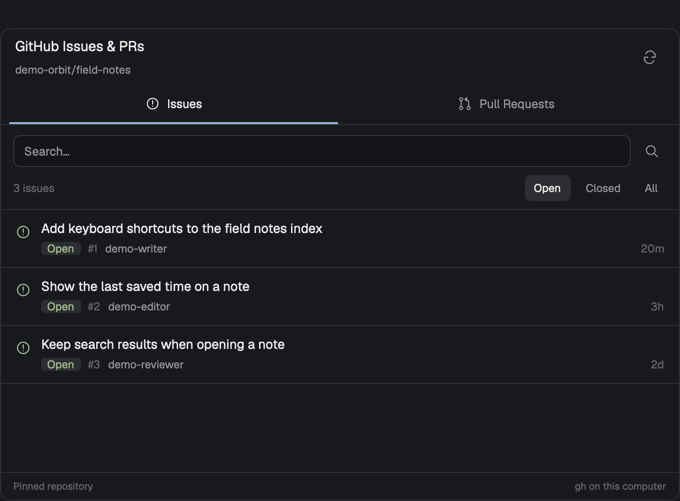

# GitHub Issues & PRs

Read GitHub issues and pull request descriptions without leaving Herdr. Follow
the focused terminal's repository and machine, or pin a repository with props.
This recipe is the build brief; the adjacent files are one implementation.

The preview is an inspected capture of the actual native list UI with public
fixture data on Herdr 0.1.15. It contains no private paths or repository names.
The bundle remains incomplete until the interaction checks below pass.

## What you see

- A panel that fills its layout block, or a 680 × 760 overlay (`place: "none"`).
- A repository header, refresh button, Issues/Pull Requests tabs, search field,
  Open/Closed/All filters, scrollable results, and machine/transport status.
- Read-only repository text. The tooltip identifies its source folder and machine.
- Rows with wrapping titles, state, number, author, and update age. A detail view
  replaces the list with Markdown, labels, and PR branch/review/change counts.
- Loading, no repository, no results, operational error, and retry states.
  Existing results remain visible after a background failure. Show machine-specific
  authentication recovery as wrapped visible text in list and detail errors, not
  only a hover tooltip. Generate help from the request's machine and CLI transport;
  do not treat CLI output as recovery instructions.
- Theme colors and bundled SVG icons. Body text is 12–13 px; the detail title is
  16 px. The header is 56 px and the footer is 28 px.
- Optional `tabs: true` mode replaces a workspace tab bar, not the panel itself.
  It adds a GitHub panel button beside the available Files/Changes buttons.

## How it behaves

- Determine the active space and tab, then use its focused or remembered terminal,
  first terminal, workspace terminal, or default folder. Read `origin` with Git.
  Accept github.com HTTPS and SSH origins; explain unsupported or missing origins.
- Debounce focus changes by 200 ms. Keep same-machine content while resolving the
  new origin. Keep same-repository results for up to two minutes. Clear old data
  on a machine/repository change; ignore stale list and detail responses.
- Query with `gh issue/pr list/view`, argv arrays, explicit repository and machine,
  and bounded command deadlines. Cache completed CLI discovery per machine.
- Refresh every two minutes or on request. Keep each type's independent state,
  applied search, and draft. Enter applies search. Show a hint for unapplied edits;
  Clear search resets the draft and applied query.
- Select a result to load its description. Back or Escape returns to the list.
  Open on GitHub opens an HTTPS github.com issue/PR URL only after activation.
  Markdown links allow only HTTP/HTTPS.
- Type tabs use unmodified Left/Right/Home/End. Buttons support keyboard activation.
  Do not install global shortcuts or consume modified navigation keys.
- In tab-bar mode, preserve tab selection, rename, close, reorder, new-tab menus,
  window controls, and panel toggling. Remember panel choice per space. Do not
  offer missing panel targets. Wheel tab changes apply only over the tab strip.
- On close, cancel timers and command watchdogs, release input/focus handles, and
  invalidate pending results. A child command can continue until its host timeout.

## Built from

- One root, `mods/github-issues-prs/`: `mod.json`, `main.js`, `github.js`, `tabs.js`,
  `icons/`, this recipe, README, and LICENSE. No required companion mod.
- `main.js`: a `gpui-kit` View and `gpui-base` buttons, inputs, scrollbars, and
  Markdown. Herdr APIs include `spaces`, `panes`, `focused`, `exec`, `props`,
  `window`, `theme`, context timers/tasks, focus handles, and URL opening.
- `github.js`: repository parsing, argv construction, machine-scoped transport,
  deadlines, diagnostic redaction, and list/detail validation.
- `tabs.js`: `layout`, `shared`, `settings`, local storage, `run`, and `openOverlay`.
  Tab context and new-tab menus require Herdr's shipped `menu` and `new-menu`.
  Program icons are host-provided; fixed icons are inside this bundle.
- Install this root as `<app-home>/mods/github-issues-prs/`. Do not copy development
  dependencies, caches, or generated SDK declarations. Keep the LICENSE notice.
- Use the default view with `mod.open` or `tab.new`, or add a `github` block to the
  existing `panel-body` stack. For the optional tab bar, set the existing `tabs`
  block's mod to `github-issues-prs` and props to `{ "tabs": true }`. Keep the
  existing `panel`/`panel-body` IDs and unrelated layout nodes. See the exact
  block examples in [README.md](README.md). Do not distribute a layout.
- Optional `repo: "owner/repo"` pins the repository and captures its initial
  workspace machine. No keybinding snippet is required. Preserve existing keys.
- Runtime dependencies: Herdr, Git, and GitHub CLI on the selected machine. Local
  Windows may use `wsl.exe --exec gh` only if native CLI discovery fails. Remote
  machines never fall back locally. Authenticate manually on the selected machine.
- Checked with Herdr App 0.1.15 on macOS. Other versions/platforms are unknown.
  Development checks use repository Vitest, TypeScript, and Biome dependencies.

## Watch out

- Commands read local/remote Git configuration and access GitHub over the network.
  The CLI's account, permissions, and environment control authentication. This mod
  does not read tokens, log in, modify repositories, or write to GitHub.
- CLI and Git diagnostics redact common credential formats. Limit each complete
  error, including generated recovery, to 1,600 characters. Reserve space for
  recovery before truncating the diagnostic. Redact and limit the recovery's
  machine name to 160 characters before JSON quoting; use the full name for routing.
  Do not share private diagnostics or screenshots without inspection.
- Return at most 100 items. Render at most 80,000 description characters. Comments,
  diffs, CI checks, GitHub Enterprise, and repository mutation are not supported.
- Tab-bar mode explicitly replaces a layout block and writes only per-space panel
  preferences to mod local storage. Revert that block before uninstalling it;
  remove the `github` block or other references before removing the mod folder.
- Disabling the mod does not delete CLI credentials or change repository files.

## Done when

Completed local checks:

1. `npm run test --workspace herdr-github-issues-prs` passes mocked regression tests
   for repository/machine selection, authentication routing, deadlines, races,
   malformed responses, search drafts, tab controls, and close cleanup.
2. `npm run check:mod --workspace herdr-github-issues-prs` passes the default native
   load and nine eager native descriptions in disposable profiles. Fixtures use
   no GitHub account or network. This is not physical interaction evidence.
3. `npm run check:types --workspace herdr-github-issues-prs` and
   `npm run check --workspace herdr-github-issues-prs` pass after SDK generation.
4. JSON, local runtime imports/assets, and `git diff --check` pass.
5. Actual list/error captures passed native checks and both status samples in
   disposable profiles. The inspected 680 × 760 list capture is `preview.png`.
   These screenshots do not prove pointer, keyboard, or authenticated behavior.

Still required before sharing:

1. In a disposable profile, load both views, inspect narrow/wide sizes and theme
   contrast, use keyboard search/clear/type tabs, read a result, and return with
   Escape. Normal terminal input and existing shortcuts must remain unchanged.
2. Verify physical tab select/reorder/rename/close/new-tab and window controls,
   panel switching, and per-space restore. Remove the panel target and confirm
   its button disappears. Close the mod during a pending request without errors.
3. Verify approved read-only local/remote GitHub access and failed authentication,
   unavailable origin, timeout/retry, rapid focus changes, and late responses.
   Do not change accounts or write to GitHub to test these cases.
4. Repeat preview inspection after UI changes. Keep private content out of the
   image, confirm it matches that version, and check all recipe links.
