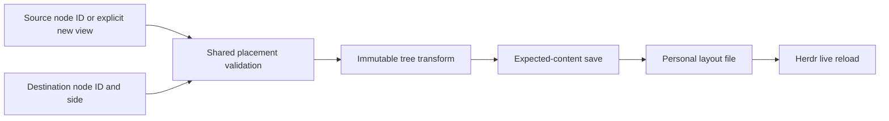

# Layout Manager

Move existing blocks and containers in a personal Herdr layout without editing JSON. Place a node beside any ordinary node, not only at a window edge. The installed-mod inventory adds new views; it does not move an existing instance by mod name.

## Features

- Move an existing block or a complete container subtree by node ID.
- Choose **Left**, **Right**, **Top**, or **Bottom** of a specific destination.
- Use the scrollable canvas or outline. Deep, small, hidden, and inactive stack children remain reachable; there is no depth cutoff.
- Use native inventory, source, destination, and placement buttons with the keyboard.
- Keep edited props drafts through Refresh and layout changes while the dialog is open.
- Add another view of an installed mod with explicit JSON props.
- Keep unavailable mods' saved nodes and props; moving a saved node does not need its mod to be installed.
- Keep the legacy managed panel, tab ordering, props, overlay, show, and hide controls.
- Clone shipped layouts before editing. Save only to the captured personal layout with an expected-content check.

The preview is schematic. It does not reproduce live dimensions or embed terminals. Pane headers, stack headers, floating content, props, and terminal split layouts move with their owning structural node; they are not independent targets. This mod does not install mods, edit keys, create tab groups, resize nodes, or delete ordinary nodes.

## Install and open

Herdr loads the source directly. Runtime Node.js packages and Python are not required.

The profile owner must fully stop Herdr before creating a development link:

```sh
ln -s ~/src/herdr-mods/mods/layout-manager ~/.config/herdr-app/mods/layout-manager
```

The destination must not exist. Do not force replacement of another installation. Use the actual app-home path if it differs. Reopen Herdr, then run:

```sh
herdr-app do mod.open --name layout-manager
```

`npm start --workspace herdr-layout-manager` runs the same command from the repository root. It does not create a link or install a layout or shortcut.

## Move an existing node

1. Open Layout Manager and check **Layout** in the header. Clone a shipped layout before editing.
2. In **Layout tree**, press the existing node's **⠿** grip and drag to a side target on the destination node.
   - Canvas targets and outline targets identify the same destination by node ID.
   - A container grip moves its complete subtree. It does not create another mod view.
   - The root/original body is a destination only, not a movable source.
3. Check the highlighted target and the **Drop … of …** label. Release to save.
   - The source cannot target itself or its own descendants.
   - A click or movement below 5 logical pixels does not save.
   - An already-adjacent same-axis placement is a no-op and does not write.

For keyboard placement:

1. Use Tab and Enter or Space to select the source's ID button in the outline.
2. Activate **Target** on the destination row.
3. Check the **Source** and **Destination** IDs, then activate a placement-side button below the canvas.

**Cancel** or **Escape** clears the ordinary source. Escape, pointer exit, an outside press, release outside a target, a new background press, Refresh, layout changes, and close cancel a pointer gesture. Keyboard selection does not itself write. Refresh keeps edited props drafts and clears selections that no longer exist; switching layouts clears pending placement. The previous editor is hidden during loading.

## Add a new mod view

Search the inventory by title or folder name. Select its title button with the pointer or keyboard and edit **Props** if needed. Props appear after ordinary placement, before the legacy controls. Drag the inventory grip beside a destination node, or activate **Add new view**, choose **Target**, then activate a placement side.

- **Add new view** always creates a new ordinary block with a collision-free ID, even if that mod already appears elsewhere.
- The new block uses that mod's props in this order: its draft, its saved managed-panel props in the current layout, then `{}`. This order also applies if you select another inventory mod before placement; that other mod's draft is not used. Invalid source props and unavailable mods cannot be added.
- Moving an existing node keeps its saved props and does not parse an unrelated draft.
- Adding an ordinary view does not create or move the legacy managed dock.
- To move one of several existing instances of the same mod, select its node ID in the canvas or outline instead of dragging from inventory.

**Open overlay** uses the current props draft without saving a placement. It honors the manifest's supported overlay kind and dimensions, but does not inherit persistent-window keys. For example, `{"footer": true}` selects Mod Manager's footer view; this editor does not infer a special mode from the target's shape.

## Tree and sizing rules

- If the destination's parent already has the required row/column axis, insert next to the destination. Otherwise, create a split container around the destination and source.
- Same-axis insertion keeps each node's `size`, `min`, and `max`. A cross-axis source move keeps those values without conversion; a fixed pixel width can become a fixed pixel height.
- A new wrapper receives the destination's parent-facing `size`, `min`, and `max`; those fields are removed from the inner destination to avoid applying the same constraint twice.
- Styling, visibility, and internal divider settings stay on their original nodes. `resizable` controls that row/column's own dividers, not its parent's allocation; it is not transferred to the wrapper.
- Existing IDs and opaque content are kept. Generated IDs use `view-<mod>` or `split`, with numeric suffixes to avoid collisions. No new ordinary node uses the reserved managed-panel namespace.
- Authored containers are not removed or collapsed after a move. An emptied row, column, or stack remains present. An emptied stack loses `active`; an affected explicit active child selects the first remaining child or the replacement wrapper. An unaffected or absent `active` stays unchanged.
- Wrapping an unframed root keeps its original ID inside the new root and promotes the shared root look/window fields. In a legacy frame, a wrapper replaces only the original-body child; the reserved frame stays the document root.

These rules have model-test coverage. Host acceptance of empty containers, native sizing geometry, and live session behavior remain unverified; see **Unverified acceptance and owner handoff**.

## Legacy managed panel

**Managed panel (legacy)** is separate from ordinary-node placement:

- Its edge controls and managed-tab grip add or move tabs in one shared dock. Changing an edge moves the entire dock.
- Drag cards to insert before another tab; **Drop to append** moves a card to the end. **Earlier** and **Later** provide the keyboard path.
- Reordering keeps saved props, saved/live active tab, and dock visibility. Missing managed mods can move or be removed without parsing a props draft.
- **Add to managed panel** and **Save managed panel props** use the selected mod's props draft.
- The remove target and **Remove from panel** remove only managed slots, not mod files. Removing the final slot restores the current, possibly edited ordinary body as root.
- Live dock tabs, **Manage**, **Hide**, and **Show panel** retain their behavior.

There is no automatic migration or extraction of managed slots into ordinary nodes. Reserved frame/dock/header/stack/slot IDs must remain intact; ordinary transforms cannot move them.

## Saves, access, and recovery

The manager reads manifests, checks entry points, reads `installed.json`, and reads the current layout. Discovery does not execute listed mods. New installations appear on open or Refresh.

Each changed placement writes only `layouts/<captured-name>.json`:

- Check the captured path, current layout name, and shipped-layout index before saving. Missing or invalid metadata blocks edits.
- Use `writeTextFile(path, next, expected)` so an external file change atomically rejects the write.
- Invalid actions, canceled gestures, duplicate releases, and no-ops do not write. A failed/stale save blocks further saves until Refresh; it is not retried or merged.
- Do not edit `layouts/.state/`, mod code, keys, or credentials. The manager makes no network requests and starts no external programs. Opening or placing another mod executes that mod with its own access.

A missing ordinary mod remains in the outline with its saved content. Missing managed mods also appear as **Unavailable** in inventory. Reinstalling the same folder name reuses saved references; development-link changes can require a full app restart.

Inspect an unexpected owned-structure error instead of deleting foreign nodes to satisfy reserved IDs. Refresh after a stale write; edited props text, including invalid JSON, stays separate for each layout and mod. Refresh reloads unedited saved props and does not apply drafts automatically.

Props drafts stay in memory only. **Close** asks for **Keep editing** or **Discard drafts and close** when any layout has drafts. Close is disabled during a save. Host dismissal, mod disable, or app exit can still discard drafts; copy important text before these actions. An already-started write can finish after close; queued saves do not start after close.

**Undo last change** in the fixed header reverses the most recent successful layout edit in this dialog. It uses the same current-layout, ownership, and expected-file-content checks as a normal save. It cannot overwrite an external edit. A no-op keeps the last undo step; a second changed save replaces it. Refresh, layout changes, or closing the dialog clear it. Undo restores layout content, not the original JSON formatting, and does not discard later props drafts. There is no redo, persistent history, or backup store. For owner testing, keep the original JSON and use a disposable personal clone. Reverting code does not undo layout-file changes. If recovery is needed, use Herdr's `ctrl-alt-shift-escape` escape hatch, then restore only the disposable layout while Herdr is stopped. Hiding/removing a view does not prove that programs started by that mod stopped.



## Development checks

From the repository root:

```sh
npm test --workspace herdr-layout-manager
npm run check:mod --workspace herdr-layout-manager
npm run check:types --workspace herdr-layout-manager
npm run check
npm test
git diff --check
```

Native checks generate ignored SDK declarations; run them before type checks. Both the base check and fixture checks use temporary `HERDR_APP_HOME` directories. They do not modify the live profile. Fixtures cover ordinary source/destination states, deep/small/hidden nodes, inactive stack children, four-side drops, root wrapping, empty containers, keyboard placement, new views, draft/Close states, enabled Undo, legacy coexistence, and existing recovery states.

Regression tests also cover draft recovery after stale saves, per-layout/mod draft isolation, late input during saves, unedited external-props reload, keyboard inventory selection, and render-scoped destination validation without revisiting layout nodes. Render eligibility is indexed once per source; release/save validation stays fresh. These are model and handler checks, not native response-time measurements.

`herdr-app check` on Herdr 0.1.15 checks eager module and element descriptions. It does not parse the supplied layout tree, perform layout/paint, or dispatch physical events. A queued `openOverlay({layout})` even accepts an invalid node type in this checker; that is not parser acceptance evidence. Do not call these checks native rendering or visual verification.

## Unverified acceptance and owner handoff

Inspected native fixture captures show the editor's appearance in those states. They do not verify physical interaction, host layout geometry, live reload, or terminal/session continuity.

The profile owner must load the updated mod with explicit approval and use a disposable personal clone to verify:

- Actual host parsing of transformed layouts, including empty containers and root wrapping.
- Same-/cross-axis sizing, constraint transfer, and unchanged internal divider behavior.
- Dragging existing blocks and containers to internal targets, target priority/highlighting, scrolling, and access to deep, small, hidden, and inactive nodes.
- Escape, outside release, pointer exit, refresh/layout changes, and close cancellation.
- Tab/Enter/Space inventory selection and placement, focus visibility, accessibility labels, and screen-reader output.
- Props draft retention across Refresh/layout changes and the fixed-header Close discard warning.
- Legacy dock operations, live reload without duplicate views, and terminal/session continuity.

Model/handler tests and eager checks do not establish these results. Do not describe the editor as interaction-verified or publish it before owner acceptance is recorded. Do not automate the user's display or change the live development link/layout as part of repository checks. An inspected native fixture preview is included; no package publication or native interaction acceptance is claimed.
