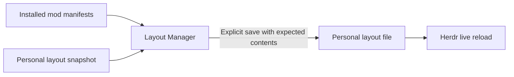

# Layout Manager

Manage mod placement in the current Herdr layout without editing JSON by hand.

## First version

- List installed mods, including development links. Search by title or folder name.
- Add a mod to a managed right panel. Tabs in the panel header switch between mods.
- Edit a panel's JSON props, show a hidden panel, or remove a managed placement.
- Open an available mod as an overlay, using its manifest's kind and dimensions.
- Keep panel references and props when a mod is absent. A same-name reinstall uses the same slot.
- Show existing integrations without changing them. A tab bar, footer, or pane header remains independent.
- Refuse edits to shipped layouts. Use **Clone current layout** to create a personal copy.

This version manages one right-side dock. It does not move arbitrary existing blocks, replace special integrations, change keys, install mods, or monitor a package manager. New installations appear when the dialog opens or you select **Refresh**. Refresh discards unsaved props drafts.

## Install and open

Herdr loads the source directly. No build output, Node.js packages, or Python runtime is needed by this mod.

The profile owner must fully stop Herdr before creating a development link:

```sh
ln -s ~/src/herdr-mods/mods/layout-manager ~/.config/herdr-app/mods/layout-manager
```

The destination must not exist. Do not use a force option to replace another installation. Use the app home's actual path if it differs from `~/.config/herdr-app`. Reopen Herdr, then run:

```sh
herdr-app do mod.open --name layout-manager
```

From the repository root, `npm start --workspace herdr-layout-manager` runs the same command. It does not create a link. No layout or shortcut is installed automatically.

## Use

1. Open Layout Manager and check **Layout** in the header.
2. Select a mod.
3. Enter a JSON object in **Props**, if the mod requires one.
4. Select **Add to right panel**.
   - An existing integration is not replaced. This action adds another view.
   - Adding the same managed mod updates its props and selects its existing slot.
5. Use the dock tabs to switch views.
   - **Hide** hides the dock.
   - **Manage** opens or closes Layout Manager.
   - **Show panel** selects a saved slot and shows the dock without a file edit.
6. Select **Remove from panel** to remove only this manager's placement.
   - Removing the last slot unwraps the original layout tree.
   - Mod files and other placements stay unchanged.

**Open overlay** uses the current props draft without saving a placement. It honors the mod's supported overlay kind, width, and height. It does not enable persistent windows or inherit a manifest's window key.

For example, `{"footer": true}` selects the footer view of Mod Manager. Layout Manager cannot determine whether that view is useful as a full-height panel. It does not infer a compact mode or replace the existing footer.

## Layout ownership and access

The mod reads `mods/*/mod.json`, checks entry-point existence, reads `installed.json`, and reads the current layout. Discovery does not import or execute a listed mod.

Only **Add to right panel**, **Save panel props**, and **Remove from panel** write a layout file:

- The target is the captured personal file `layouts/<name>.json`.
- The current layout name and shipped-layout index are checked before each write.
- `writeTextFile` atomically refuses a write when the file no longer matches the loaded snapshot.
- A failed or stale write blocks further saves until Refresh.
- Missing or invalid shipped-layout metadata blocks editing.
- Existing node IDs, props, and layout fields remain in the original body. Root look and window fields move to the new outer frame.
- The reserved `layout-manager-*` structure must remain intact. Unexpected edits are rejected instead of removing foreign nodes.
- The mod never edits `layouts/.state/`, mod code, credentials, or keys.

Layout Manager itself makes no network requests and runs no external programs. Opening or placing another mod executes that mod with its own access. Removing a placement does not guarantee that programs started by the mod stop.



## Missing mods and recovery

A missing mod's saved reference is not deleted. The manager lists it as **Unavailable**, with its saved props. Herdr controls the missing view and can retain an older runtime copy. Reinstall the same folder name, then refresh the manager. External development-link changes can require a full app restart.

A different installation name is a different mod. Add the new name and remove the old managed slot explicitly.

For an unexpected owned-structure error, inspect the personal layout before making changes. Do not delete unrelated blocks to satisfy a reserved ID. A stale-write error means the file must be loaded again; the manager does not merge competing edits. **Refresh** discards unsaved props drafts.

Herdr's `ctrl-alt-shift-escape` escape hatch remains available. It returns to the default layout and sets the selected layout and keys aside. Layout Manager does not implement a separate backup, migration, or undo store.

## Development checks

From the repository root:

```sh
npm test --workspace herdr-layout-manager
npm run check:mod --workspace herdr-layout-manager
npm run check:types --workspace herdr-layout-manager
npm run check
git diff --check
```

Native checks generate the ignored `gpui-kit.d.ts`; run them before type checks. The view fixtures cover populated, managed, missing, shipped, loading, empty, error, large-list, dock, and dock-recovery states. Fixture checks use an isolated app home and never mutate the live layout.

A live smoke check on Herdr 0.1.15 used temporary copied mods and a disposable personal layout. It verified discovery, two-panel addition with props, the dock header, selection, hide/show, and final-slot removal. Screenshot inspection found and corrected an inventory sizing defect. The original personal layout file was not changed by this smoke check.

The profile owner must still create the development link with Herdr stopped, reopen the app, and verify that installation. No GitHub publication or packaged preview image is included.
