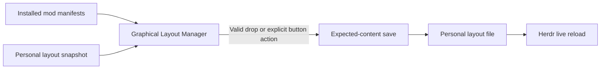

# Layout Manager

Arrange installed Herdr mods with a graphical layout preview. Drag mods into a managed panel, move the panel to any window edge, and change its tab order without editing layout JSON.

## Features

- Search installed mods by title or folder name, including development links.
- Drag a mod's **⠿** grip to **Left**, **Right**, **Top**, or **Bottom** in the preview.
- Drag the **Panel** grip to another edge to move the entire managed panel.
- Drag a managed card onto another card to insert it before that card. **Drop to append** moves it to the end.
- Use each card's **Earlier** and **Later** buttons to change tab order with the keyboard.
- Drop a managed card on the remove area to remove its placement, not its files.
- Edit JSON props, show a hidden panel, or open a mod as an overlay.
- Keep missing mods' references and props for a same-name reinstall.
- Keep existing integrations unchanged. A tab bar, footer, or pane header remains independent.
- Refuse edits to shipped layouts. **Clone current layout** creates a personal copy.

The manager owns one panel with tabs. Moving a mod to another edge moves that whole panel, including its other tabs. The preview is schematic; it does not move arbitrary existing blocks or resize them. This mod does not change keys, install mods, or monitor a package manager. New installations appear when the dialog opens or you select **Refresh**.

## Install and open

Herdr loads the source directly. No build output, Node.js packages, or Python runtime is needed by this mod.

The profile owner must fully stop Herdr before creating a development link:

```sh
ln -s ~/src/herdr-mods/mods/layout-manager ~/.config/herdr-app/mods/layout-manager
```

The destination must not exist. Do not use a force option to replace another installation. Use the app home's actual path if it differs from `~/.config/herdr-app`. Reopen Herdr, then run:

```sh
herdr-app do mod.open --name layout-manager
```

From the repository root, `npm start --workspace herdr-layout-manager` runs the same command. It does not create a link. No layout or shortcut is installed automatically.

## Use

1. Open Layout Manager and check **Layout** in the header.
   - Clone a shipped layout before editing it.
2. Find a mod in the left list. Select it to edit **Props** if needed.
3. Press its **⠿** grip and drag to an edge of **Visual layout**. Release on the target to save.
   - A click or movement below 5 logical pixels does not save.
   - A new placement uses that mod's props draft, or `{}` by default.
   - An existing integration is not replaced. This action adds another view.
   - An existing managed mod keeps its saved props and stable slot. Use **Save panel props** to change its props.
   - The **Place selected mod** buttons provide the same placement action without dragging.
4. Drag the **Panel** grip to another edge to move all managed tabs together.
5. Drag card grips inside the preview to change tab order.
   - Release on another card to insert before it.
   - Release on **Drop to append** to move to the end.
   - Reordering keeps saved props, the saved and live active tab, and panel visibility.
   - Press Tab to reach a card's **Earlier** or **Later** button. Press Enter or Space to move that card.
   - Boundary moves and editing in blocked states are disabled. A card does not need mouse selection first.
6. Drop a managed card on the remove area, or select **Remove from panel**.
   - Removing the last slot restores the original layout body as root.
   - Missing mods can be moved, reordered, and removed without valid props drafts.
   - Mod files and other placements stay unchanged.
7. Use the live dock's tabs to switch views.
   - **Hide** hides the dock.
   - **Manage** opens or closes Layout Manager.
   - **Show panel** selects a saved slot and shows the dock without a file edit.

A valid drop saves immediately. Release outside a target to cancel. **Escape**, moving the pointer outside the dialog, an outside press, Refresh, and closing the dialog also cancel a gesture. Dragging uses the mouse within this dialog, not operating-system drag-and-drop. Refresh discards unsaved props drafts.

**Add to panel** adds to the current panel edge, or to the right if no managed panel exists. **Open overlay** uses the current props draft without saving a placement. It honors the mod's supported overlay kind, width, and height. It does not enable persistent windows or inherit a manifest's window key.

For example, `{"footer": true}` selects the footer view of Mod Manager. Layout Manager cannot determine whether that view is useful as a full-height panel. It does not infer a compact mode or replace the existing footer.

## Layout ownership and access

The mod reads `mods/*/mod.json`, checks entry-point existence, reads `installed.json`, and reads the current layout. Discovery does not import or execute a listed mod.

Valid drops, **Place selected mod**, **Add to panel**, **Save panel props**, and **Remove from panel** write a layout file:

- The target is the captured personal file `layouts/<name>.json`.
- The current layout name and shipped-layout index are checked before each write.
- `writeTextFile` atomically refuses a write when the file no longer matches the loaded snapshot.
- A failed or stale write blocks further saves until Refresh. A gesture is not retried.
- Missing or invalid shipped-layout metadata blocks editing.
- Existing node IDs, props, and layout fields remain in the original body. Root look and window fields move to the outer frame.
- The reserved `layout-manager-*` structure must remain intact. Unexpected edits are rejected instead of removing foreign nodes.
- Existing right-dock files work without migration. Other edges use the same frame, dock, header, stack, and slot IDs.
- The mod never edits `layouts/.state/`, mod code, credentials, or keys.

Layout Manager itself makes no network requests and runs no external programs. Opening or placing another mod executes that mod with its own access. Removing a placement does not guarantee that programs started by the mod stop.



## Missing mods and recovery

A missing mod's saved reference is not deleted. The manager lists it as **Unavailable**, with its saved props. Herdr controls the missing view and can retain an older runtime copy. Reinstall the same folder name, then refresh the manager. External development-link changes can require a full app restart.

A different installation name is a different mod. Add the new name and remove the old managed slot explicitly.

For an unexpected owned-structure error, inspect the personal layout before making changes. Do not delete unrelated blocks to satisfy a reserved ID. A stale-write error means the file must be loaded again; the manager does not merge competing edits. **Refresh** discards unsaved props drafts.

Herdr's `ctrl-alt-shift-escape` escape hatch remains available. It returns to the default layout and sets the selected layout and keys aside. Layout Manager does not implement a separate backup, migration, or undo store.

## Development checks

From the repository root:

```sh
npm test --workspace herdr-layout-manager
npm run check:mod --workspace herdr-layout-manager
npm run check:types --workspace herdr-layout-manager
npm run check
git diff --check
```

Native checks generate the ignored `gpui-kit.d.ts`; run them before type checks. Fixtures cover populated, managed at all four edges, active drag targets, missing, shipped, loading, empty, error, large-list, dock, and dock-recovery states. Fixture checks use an isolated app home and never mutate the live layout. Unit tests exercise gesture handlers, threshold movement, target feedback, cancellation, props handling, stale saves, and layout switches.

The graphical dialog was opened and inspected with `herdr-app shot` on Herdr 0.1.15 without a layout-file edit. Native render checks do not prove physical pointer dispatch. The profile owner must still verify dragging, Escape, leaving the dialog, tab ordering, keyboard button activation, screen-reader labels, and dock placement in a disposable personal layout. No pointer automation is used on the user's display.

No GitHub publication or packaged preview image is included.
