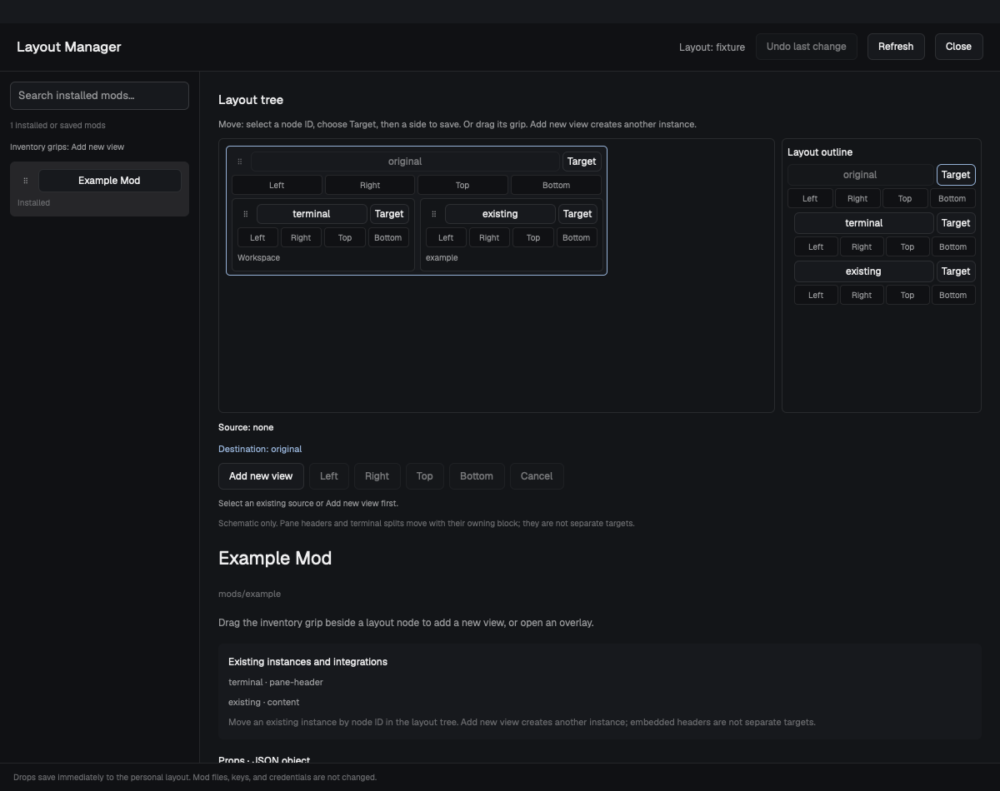

# Layout Manager

Build a native editor for an existing personal Herdr layout tree. Move blocks and complete containers beside a specified node; keep **Add new view** distinct from moving an existing instance. Retain the previous managed dock without automatic migration.

This recipe is the build brief; the adjacent files are one implementation. All links resolve from this mod root, `mods/layout-manager/`. See [README.md](README.md) for use, recovery, and owner acceptance. No external runtime assets are needed. The inspected actual-app `preview.png` shows a disposable fixture at 1200 × 950, not live terminal geometry. The bundle remains incomplete until required owner interaction acceptance is recorded.

## What you see

- A 1000 × 680 dialog with theme colors and 13px base text.
- A 58px `chrome` header: **Layout Manager**, current layout, **Undo last change**, **Refresh**, and **Close**.
- A 240px inventory with search and scrolling mod cards. Each title is a native keyboard-selectable button. Each inventory grip means **Add new view**, not move by mod name. Initially show at most 100 cards; **Show more** adds 100.
- A scrolling editor with 22px padding. **Layout tree** has a 330px-high row containing a two-axis scrollable schematic canvas and a 240px scrollable outline.
- Every ordinary node has its ID, a move grip in the canvas, a source button, a **Target** button, and four labeled side drop targets. The outline also has four side targets. Root source controls are disabled; root destination controls remain available.
- Keep every structural depth reachable. Show hidden nodes as labeled cards; include inactive stack children. Use minimum schematic card sizes rather than live dimensions so tiny nodes can be selected.
- Below the canvas, show **Source** and **Destination** IDs. While hovering a valid ordinary target, show **Drop <side> of <ID>**. Include **Add new view**, four placement-side buttons, and **Cancel**.
- Selected-mod details follow ordinary placement, before legacy controls. Include existing reference IDs, JSON props, managed-panel actions, and **Open overlay**. State that props drafts survive Refresh/layout changes only while the dialog stays open.
- A separate **Managed panel (legacy)** section contains its four window-edge targets, panel grip, managed cards with **Earlier**/**Later**, append/remove targets, and explicit managed placement buttons.
- A Close request with unsaved drafts shows **Keep editing** and **Discard drafts and close** beneath the fixed header. Do not put this warning inside the scrolling editor.
- Shipped layouts show a clone-name input and **Clone current layout**. Disable edits there.
- The live dock retains its 36px header with tabs, **Manage**, and **Hide**. No discovery or input state is created in dock mode.

## How it behaves

### Ordinary placement behavior

- Select sources by exact structural node ID. Never infer which existing instance to move from a mod name.
- Traverse only `children`; treat content, props, pane trees, headers, floating blocks, and unknown fields as opaque. They move with their owning node.
- A grip press starts a pending gesture. Use window-relative `event.position`; at least 5 logical pixels activates it. Keep source kind and node ID/mod name, not array indices.
- Existing-node sources move their full subtree, with IDs and saved props. They work when a mod is unavailable and do not parse unrelated props drafts.
- Inventory sources add a new block with that mod's explicit props draft. Allow multiple ordinary instances of the same mod; reject unavailable mods and invalid props. Do not create or reposition a managed dock for ordinary insertion.
- Reject root/body movement, self-placement, missing IDs, managed boundaries, and placing a container beside its own descendants. Allow moving a descendant beside an ancestor after detaching it.
- For the requested side, reuse the destination parent when it has the required row/column axis. Otherwise, create a row/column wrapper around source and destination. Detach the source before resolving the target's final index.
- Return the original root for an already-adjacent same-axis no-op. Do not save unchanged trees or rewrite their formatting.
- Keep existing node fields except the specific sizing/root transfers below. Do not prune or collapse authored containers.
- Repair only affected explicit stack active-child references. Select the first remaining child if the active child was removed; remove `active` if empty; map a wrapped active target to its wrapper. Preserve unrelated and absent active fields.

### Sizing and root rules

- Same-axis insertions retain each node's constraints. Cross-axis source moves keep their existing `size`, `min`, and `max` without conversion.
- Transfer the target's parent-facing `size`, `min`, and `max` to a new wrapper, removing them from the inner target. Keep visibility, paint, padding, and internal container configuration on the original node.
- `resizable` controls a row/column's own divider behavior and is not inherited. Do not transfer it with parent-facing constraints. New wrappers use the host default.
- Wrapping an unframed root promotes the shared `ROOT_FIELDS` contract to the new root and retains the original node ID inside it. Do not duplicate this field list in `tree.js`.
- A legacy layout keeps `layout-manager-frame` at document root. Operate only within its original-body subtree; wrapping that body replaces only its frame child.
- Retain empty rows/columns/stacks. Model tests cover this rule, not actual host parser acceptance or geometry.

### Keyboard and cancellation

- Use native `Button` controls with stable IDs, enabled tab stops, focus borders, and explicit accessibility labels. Include inventory selection so keyboard users can choose a new view without clicking a card.
- Keyboard sequence: select a source ID (or **Add new view**), select a destination's **Target**, then activate a side button. Show source and destination before saving. Use the same placement validator as pointer targets.
- Use `on_mouse_down`, `on_mouse_move`, `on_mouse_up`, `on_hover`, and `on_mouse_down_out`. Do not use external-file `on_drop` or assume native internal drag payload support.
- A child drop target, including an invalid one, stops event propagation so an ancestor cannot accept that event. Give canvas and outline targets distinct interaction keys even when they address the same node/side.
- Clear gesture state before asynchronous work. A valid changed placement saves immediately, at most once per gesture. Invalid/no-op/canceled actions do not write.
- Cancel a pointer gesture on Escape, outside/root release, pointer exit, outside/background press, Refresh, layout switch, and close. Escape and **Cancel** also clear the ordinary source.
- Focus the root handle on grip press only, not on render. There is no pointer capture; pointer exit must cancel rather than leave a stale gesture.
- Reconcile selected IDs after save/refresh. Clear source/destination on layout-name changes. Hide the previous editor during loading, and reject old inventory-selection callbacks. A closed view must not update native input state or notify from a pending task.
- Retain edited props text, including invalid JSON, separately for each layout and mod in this dialog. Refresh must reload unedited saved props, not erase drafts or apply them automatically. A successful managed-props save clears only the submitted draft; later input remains a draft. Removing a panel must not erase draft text.
- Warn before this mod's Close button discards drafts. Close is disabled while saving. Host dismissal, disabling the mod, or quitting the app can still release the view; session drafts are not persistent.

### Legacy compatibility

- Keep the strict reserved frame, dock, header, stack, and slot validation. Do not repair foreign edits by deleting nodes.
- The reserved frame has exactly the current ordinary body and `layout-manager-dock`. A row/column and child order determine left/right/top/bottom; do not persist edge metadata.
- Dock children remain `layout-manager-header` and `layout-manager-stack`. Slots remain `layout-manager-mod-<folder>`. Header props contain display titles; slot content contains mod name and props.
- Managed edge actions move the entire shared dock. Existing managed tabs keep props; save props only through the explicit managed action.
- Card drop-before/append and **Earlier**/**Later** reorder tabs without live select/show commands. Missing managed mods remain movable/removable.
- Removing the last slot restores the edited ordinary body and current outer root settings. Do not extract managed slots into ordinary nodes or automatically migrate files.
- **Open overlay** uses draft props and supported manifest kind/dimensions, without persistent keys. **Show panel** selects the saved slot and reveals the live dock without editing a file.

## Built from

Use the existing mod root `mods/layout-manager/`. Add its source to the owner's existing mod setup; open the dialog with `herdr-app do mod.open --name layout-manager`. Do not distribute a layout or replace keybindings. No `keys.json` is needed. Stop Herdr before the owner creates a development link; see [installation](README.md#install-and-open).

The checked host is Herdr 0.1.15. Other-version compatibility is unknown. Theme colors come from `theme()`; mod props and overlay dimensions are explicit customization points.

- `main.js`: graphical dialog, ordinary selection/gesture/outline UI, and lightweight `{mode:"dock"}` header.
- `tree.js`: immutable ordinary traversal, shared eligibility validation, and relative placement.
  - `ordinaryNodes(root)` returns preorder `{node,parent,depth}` entries for the ordinary body only; its root has `parent:null`.
  - `placementError(root, source, targetId, side)` returns `""` or a specific error. Sources are `{kind:"node",id}` or `{kind:"new",name,props}`; sides are left/right/top/bottom.
  - `placementValidator(root, source)` returns `{entries,error(targetId,side)}`. Reuse it within one render: validate the tree/source once, index descendants once, then check each destination in constant time. Never reuse render eligibility for a pointer release or save.
  - `placeNode(root, source, targetId, side)` revalidates and returns the changed copy, or the original root for a true no-op.
- `model.js`: structural validation, JSON-safe copying/props checks, shared `ROOT_FIELDS`, references, and existing managed `addPanel`, `removePanel`, `dockPosition`, `moveDock`, `reorderPanel` operations.
- `runtime.js`: manifest discovery, missing managed references, guarded snapshots/saves, no-op save suppression, and overlay specifications. Inject I/O for tests.
- `mod.json`: `place:"none"`, dialog width 1000 and height 680.
- `tree.test.js`, `main.test.js`, `model.test.js`, `runtime.test.js`, `jsconfig.json`, and scripts provide checks. Runtime code does not depend on Node.js; development scripts may.
- Herdr APIs: `appHome`, `readTextFile`, `writeTextFile`, `shared("layout")`, `layout`, `theme`, `openOverlay`, `closeOverlay`, `props`, and `run`. Commands: `layout.clone`, `layout.select`, `layout.show`, `layout.hide`, and `mod.open`.
- `fs/promises` supplies directory listing and existence checks. Read through development-link paths; do not require `Dirent.isDirectory()`.

## Watch out

- Target only the captured personal `layouts/<name>.json`. Check name/path, current layout, and refreshed `installed.json` before saving. Fail closed on missing/invalid metadata or reserved ownership errors.
- Use `writeTextFile(path, next, expected)`; never use an unconditional write or `layout.set` to bypass stale-file protection. Invalid transforms must not write.
- Compare unchanged tree JSON after guard/validation checks. Return the original snapshot and raw formatting for a no-op.
- A failed/stale save blocks edits until Refresh, without retry or merging. Do not edit layout click-state files, keys, credentials, or mod code.
- Keep one in-memory undo step after a successful changed save. **Undo last change** restores its prior tree through the same guarded save path; it must not overwrite external edits. No-op saves retain the step. Undo consumes it; another changed save replaces it. Refresh, layout switch, and close discard it. Preserve later props drafts and restore unedited saved props. Undo restores content, not original JSON formatting; do not add redo or persistent history.
- Create input states and the focus handle in init and release on close. Keep drafts in memory only. Do not start a queued save after close; an expected-content write already in progress can complete on its captured file. Every callback/task uses its own `cx`. No polling timers, network calls, mod installation, or external program launch are added.
- Opening/placing another mod executes it with its own access. Hiding/removing a view does not establish that external programs stopped.
- Use disposable personal clones and retain original JSON for owner tests. Reverting source does not undo saved layouts. Keep recovery instructions and the Herdr escape hatch in the README; do not add a persistent undo/backup store.

## Done when

### Completed locally

- All 597 model, runtime, and handler tests pass.
- Type checking, workspace Biome checks, and `git diff --check` pass.
- Herdr 0.1.15 accepts the base module and 36 eager native-description fixtures in temporary profiles. No live profile is changed. These checks do not test physical interaction or layout geometry.

Run the [README checks](README.md#development-checks). Native base and fixture checks must use temporary `HERDR_APP_HOME` values and clean them up. Generate ignored SDK declarations before type checking. Include `tree.js` in both type and fixture-copy inputs.

Model tests must cover all sides, immutable frozen inputs, containers, source/destination ancestry, same-/cross-axis constraints, empty containers, stack repair, root fields, unique IDs/prototype property names, opaque fields, no-ops, legacy boundaries, and legacy final removal. Handler/runtime tests must cover actual rendered control wiring, keyboard labels/tab stops, deep/hidden/inactive access, target priority, thresholds, duplicate release, cancellation, blocked states, stale writes, layout changes, and async close. Also test invalid/valid drafts through stale-save recovery, per-layout/mod isolation, unedited external-props reload, late input during saves, Close discard, keyboard inventory selection, and render-scoped destination checks without revisiting structural nodes. Keep prior managed tests passing.

Eager native-description fixtures cover ordinary deep/small/hidden/container sources, four internal sides, new views, stack children, root wrapping, empty containers, keyboard placement, legacy coexistence, and prior recovery states. Herdr 0.1.15 `check` does not parse layout nodes or perform layout/paint. Do not represent it as geometry or physical-interaction proof.

### Still required

The actual-app preview and two isolated capture states have been inspected. They establish appearance only. Model and handler checks establish the documented contracts, not physical interaction. Host parser acceptance, actual sizing/paint, physical dragging, keyboard and screen-reader behavior, draft/Close interactions, and session continuity remain owner acceptance in a disposable personal clone. See [the retained handoff](README.md#unverified-acceptance-and-owner-handoff). Do not modify the live profile/link or automate the user's display for checks. Do not describe this iteration as interaction-verified or publish it before owner acceptance is recorded.
