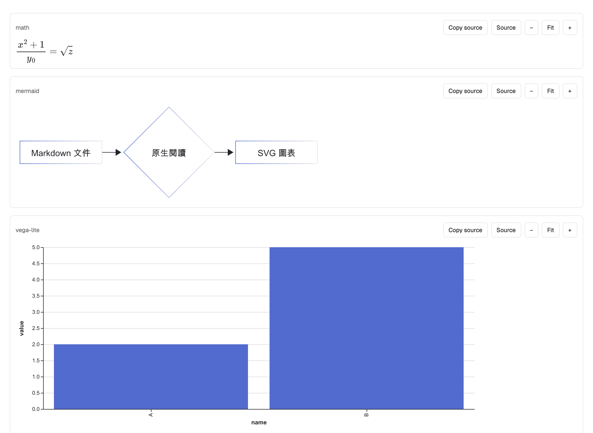

# Markdown Reader

Read a local Markdown file in a native Herdr pane. Keep prose and code as native text, and generate local SVG for display math, official Mermaid.js diagrams, and static Vega-Lite charts.

This recipe is the build brief. The adjacent files are one implementation. The preview is cropped from the actual native reader's graphic cards; the fixture's private file-path header is removed. It is not a browser screenshot or generated design image.

Sharing status is incomplete: the source bundle and automated implementation checks are prepared, but owner-operated acceptance and Community publication remain open.

## What you see

- A focusable pane or a 1,000 × 760 dialog, with no default docking (`place: "none"`). Pane size follows the host layout.
- A 44-pixel header with the file path, Reload, and Source. The dialog also has Close.
- Native Markdown text, tables, read-only task markers, lists, quotes, and compiled footnote links. Use 16-pixel text, 18-pixel document padding, and 14-pixel block gaps.
- Read-only syntax-highlighted code cards and full-document source mode.
- Graphic cards with Copy source, Source/Render, Fit, and zoom controls. Show block errors with the original source, without hiding other content.
- Theme colors from `theme()`, light/dark SVG generation, and an explicit warning when inline math remains TeX source.

## How it behaves

- Open through `tab.new` or `pane.split`, with props `{ file, root, on: null }`. Both paths are absolute. An optional fragment selects a heading after load. A non-null machine identity is rejected before local reads.
- Read UTF-8 `.md` and `.markdown` files up to 1 MiB. Reject missing, binary, invalid UTF-8, non-regular, oversized, changed, or outside-root files rather than truncating them.
- Parse Markdown to an AST with GFM/math extensions. Preserve nested containers, definitions, relative links, and footnotes. Do not split Markdown with regular expressions or rasterize the whole document.
- Use native `TextView.html()` for trusted compiler output, native `Editor`/`EditorState` for code, and `image(path)` for full-color assets. Prepare editor states outside render; finish each single-use element before attaching it to a parent.
- Send one file-based request to a local Node helper per document batch, using `herdr.exec()` and argument arrays. Return a bounded JSON manifest, not HTML scripts or a web server.
- Render display TeX with MathJax SVG. Render Mermaid with the official bundled Mermaid.js in one sandboxed Puppeteer/Chromium browser per batch. Compile Vega-Lite and render static SVG in a bounded worker. Sanitize SVG, resolve styles, and bound bytes, dimensions, and pixel area before native display.
- Watch the local root; debounce changes by 250 ms and use a 10-second fallback if watching fails. Keep the last good result and outer scroll handle after a failed refresh. Cancel pending work, discard stale results, and close owned workers/browsers.
- Keep generated assets and expiring reader leases under `<app-home>/data/markdown-reader/`. Bound assets to 64 MiB, protect active assets, and collect stale jobs.
- Open local Markdown links in reader tabs, fragments through a native scroll handle, and HTTP(S)/mail links only after an explicit click. Never execute code fences or authored HTML.

## Built from

- One shared entry: this `mods/markdown-reader/` mod root, containing `main.js`, `mod.json`, runtime/helper/model/document/file/cache modules, `renderers/`, `package.json`, this recipe, `preview.png`, and [dependency notices](DEPENDENCIES.md). Keep relative imports inside the folder.
- Host APIs: `View`, native element builders, `TextView`, `EditorState`, `Editor`, `ScrollHandle`, `Scrollbar`, `props`, `theme`, `settings`, `exec`, `watchFolder`, `nextCommand`, `run`, and `closeOverlay`. Follow the installed SDK, not a newer cached crate.
- Node.js 26; pinned unified/remark/HAST packages, MathJax, official Mermaid.js, Puppeteer, Vega/Vega-Lite, image-size, and an XML parser. Use the adjacent `package.json` and retain its KaTeX security override. Install dependencies locally; do not bundle a development cache, generated SDK, credentials, or a browser binary.
- For this checkout, use root `npm ci`, then `npm run setup:browser --workspace herdr-markdown-reader`. For a standalone copy of this mod folder, use `npm install --omit=dev`, then `npm run setup:browser` inside it. Browser setup is explicit, not performed when opening a document.
- Stop Herdr before linking/copying the mod into `<app-home>/mods/markdown-reader`, then reopen it. Open a tab with explicit file/root props in an existing local space. Do not distribute or replace a layout or keybindings. No `keys.json` is needed.
- An optional [Files integration preparation tool](docs/files-integration.md) generates a personal clone from the owner's supported installed Files source and a personal layout outside this bundle. It is not a required companion for opening the reader by command, and no generated companion or whole profile is distributed here. Do not treat the generated clone as an independently published bundle.
- Native checks/captures used Herdr App 0.1.15 on Apple Silicon macOS. Other native platforms are unverified. [Native fixture documentation](docs/native-fixture.md) explains isolated reproduction.

To rebuild from an empty folder, first create a `View` and manifest for the pane above. Implement a content-only recursive document model and host I/O separately from the Node helper. Add renderer adapters, bounded asset/cache handling, safe navigation, and stale-result cleanup. Use public dependency APIs, not Morsel source. Add the fixture and failure tests described below, then compare native captures with the stated support matrix rather than requiring browser-identical pixels.

## Watch out

- Herdr mods are trusted code. This mod runs local Node and headless Chromium, reads selected local documents/resources, writes its cache, and opens clicked external links through the OS. It never edits source Markdown.
- Dependency/browser setup needs package-download access. Document rendering blocks authored network/file loads before Mermaid execution and denies Vega resources. Do not disable Chromium's sandbox to make a check pass.
- Relative resources must remain within the canonical root. No automatic remote images, authored SVG, data URLs, JavaScript, Mermaid configuration directives, or document-controlled commands are allowed.
- Canonical-path and file-identity checks are not an OS sandbox against a hostile concurrent local directory writer. Use an owner-controlled stable workspace.
- Inline math is unavailable on the checked app. Preserve visible TeX source and the warning. Display math is not proof of inline support or full LaTeX support.
- Vega is a bounded static subset. There are no tooltips, parameter controls, animations, remote data, or expansive generators. Unsupported specifications show source/errors.
- Normal cleanup and timeouts are tested. A forced app crash has only helper deadlines and lease expiry as recovery paths. Herdr's normal quit cleanup has a 250 ms budget.
- No binding conflicts are introduced. Live-profile installation, clipboard/selection/scroll interaction, arbitrary SVG fidelity, and Community publication remain unverified. Do not call this mod gallery-published or the owner's profile verified.

## Done when

Completed implementation checks:

- The recipe and readable actual PNG preview sit beside `main.js` and `mod.json`. Links resolve from this mod root; no layout, private profile, generated SDK, dependency tree, or browser binary is included.
- Repository formatting, fixture tests, types, and native-description checks pass. The standalone runtime can install dependencies and render a sample without outside source imports.
- Real Chromium tests deny authored requests before rendering, strip unsafe SVG, recover from malformed/timeout input, and verify owned process exit. Worker, FIFO, byte/pixel, path, image, lease, and stale-result regressions pass.
- Isolated native captures show prose, GFM, code, display math, Chinese Mermaid, static Vega-Lite, source/loading/error states, light/dark themes, and narrow width. The captures do not operate the real profile or clipboard.

External acceptance remains open:

- The profile owner installs/activates the reader and any optional personal Files integration, then checks actual clicks, fragments, selection/copy, scrolling, zoom, refresh, and unchanged normal app use.
- A Herdr maintainer supplies a supported inline-asset API, and native baseline/wrapping/copy tests pass before any full inline-math claim.
- Community publication requires a separate publication decision and default-branch/topic/listing checks. This pull request is not that publication.

See [verification and external handoff](docs/verification.md) for evidence, restrictions, and recovery.
