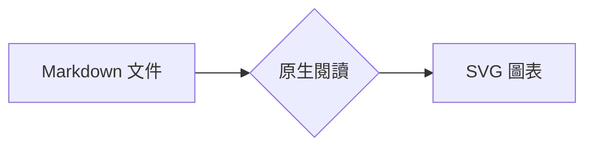

# Markdown Reader

Native text, **bold**, _italic_, ~~strikethrough~~, and `inline code`. 中文閱讀測試。

| Feature   |      Result |
| :-------- | ----------: |
| GFM table | Native text |
| Chart     |  Static SVG |

- [x] Read-only task
  - Nested list item
- [ ] Pending task

> Quoted text with a [local document](linked.md#linked-heading).
>
> ```js
> const message = "中文 code";
> console.log(message);
> ```

A footnote reference[^note] and an [internal heading](#mathematics).

## Mathematics

Inline math remains visible as source: $x^2 + y^2 = z^2$.

$$
\frac{x^2 + 1}{y_0} = \sqrt{z}
$$

## Mermaid



## Vega-Lite

```vega-lite
{
  "data": {"values": [{"name":"A", "value":2}, {"name":"B", "value":5}]},
  "mark": "bar",
  "encoding": {
    "x": {"field":"name", "type":"nominal"},
    "y": {"field":"value", "type":"quantitative"}
  }
}
```

[^note]: Footnote content is compiled to explicit HTML and local navigation targets.
