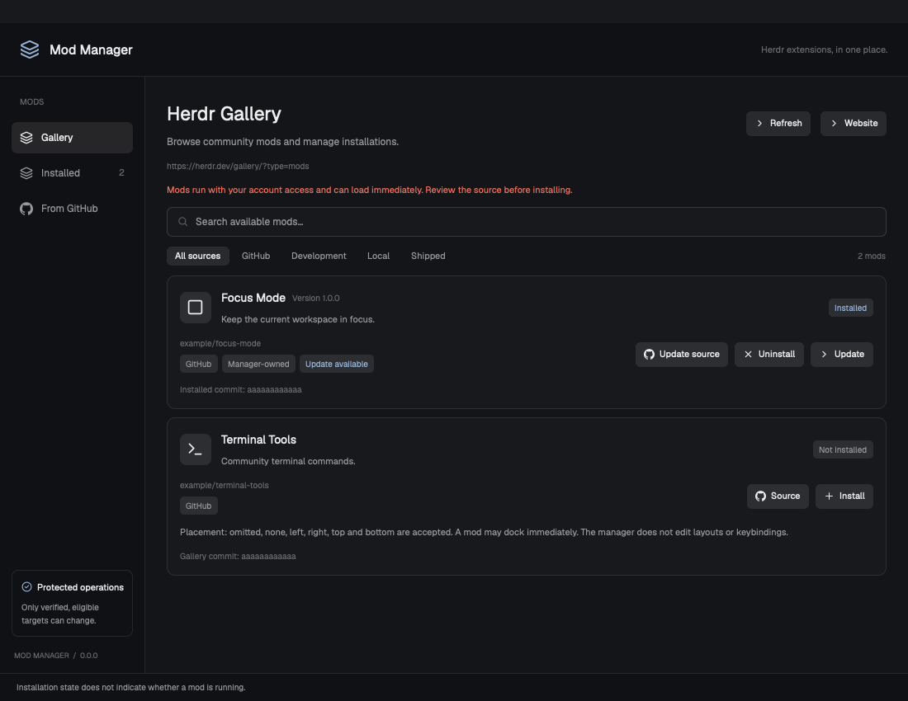

# Mod Manager

Browse the Herdr Gallery, inspect installed mods, and install, update, or uninstall trusted public GitHub mods. This recipe is the build brief. The adjacent files are one implementation, not the only way to build it.



**Bundle status: incomplete.** An inspected 1100 × 850 actual native Gallery screenshot with public fixture data is included as `preview.png`. Gallery/error captures passed native checks and both status samples on Herdr 0.1.15; owned processes were stopped. These captures do not test interactions. The required native interaction checks below remain open.

## What you see

- A centered dialog, 1000 px wide and 720 px high. The manifest uses `place: "none"`, so opening the dialog does not add a docked panel.
- A 65 px header with the title and Close button, a 176 px navigation column, and a 34 px status footer. Navigation contains Gallery, Installed, and From GitHub.
- Search, source filters, a result count, and scrollable mod cards. Cards show the title, description, source, installation state, recorded version or commit, protection reasons, and permitted actions. Verified GitHub cards include Source for code review. Results appear in batches of 50.
- Loading, empty-search, error, progress, update, ownership-migration, and uninstall-confirmation states. A read-only banner gives the backend failure reason and Retry local backend. Show warnings expands a scrollable list in batches of 20. Errors must not look like successful empty results.
- Colors from `theme()`, including canvas, chrome, surface, border, foreground, muted, accent, and blocked. Light and dark appearance still need visual review.
- An optional 97 px sidebar footer with Mods, Settings, and Add machine. Below
  160 px sidebar width, it shows icons with tooltips. Settings has an indicator
  when a Herdr update is ready.

## How it behaves

- Open or close the installed dialog with `herdr-app do mod.open --name mod-manager`. Close uses `closeOverlay(props().overlay)`; Herdr also closes dialogs with Escape.
- Start Gallery loading and installed-mod discovery independently when the dialog opens. A slow Gallery request must not block an otherwise-ready Installed page. Search and filters operate on the full loaded list, not only the visible batch.
- Fetch Gallery metadata from `https://assets.herdr.dev/mods/index.json`. Keep the repository, recipe path, mod folder, and commit from each selected card. Website opens `https://herdr.dev/gallery/?type=mods` through the host browser API; URL delivery does not prove browser display.
- Source opens the selected card's validated GitHub repository, pinned to its recorded commit and exact case-sensitive recipe directory. When Update is available, label this action Update source and open the checked update candidate, not the older installed commit. Use the repository root only when no commit is recorded. A bundle opens its recipe directory; the user must locate the selected mod folder. It does not install or change files. Show the exact URL when browser delivery fails; successful delivery does not prove browser display.
- Discover installed manifests and source identity. Keep GitHub, development, local, and shipped sources distinct. A matching name alone must not establish ownership.
- From GitHub accepts a public `https://github.com/owner/repository` URL, optionally ending in `.git`, and an optional case-sensitive Mod directory such as `mods/github-issues-prs`. Use the default branch. A blank directory selects the repository root; a supplied directory must contain `mod.json` and `main.js` directly. Install under the final directory component and retain the exact source path for discovery, updates, and uninstall. Allow different mod directories from the same repository, but reject duplicate sources and existing destinations. Reject unsafe relative directories and private, credential-bearing, SSH, local, and branch/tree URLs. Use a Gallery card to select a recipe bundle mod. Do not install companion mods, layouts, or keybindings automatically.
- Install only after structural checks. Stage downloads outside `mods/`, then publish a complete package with an atomic rename that refuses an existing destination. Do not run downloaded entry points, package scripts, hooks, or package managers during validation.
- Check updates before enabling Update. Show the current mod and checked/total count during the batch. Stop checks waits for the current repository, then stops before the next; Close also stops further checks. Retain completed candidates and report actual checked/failed counts. Stop on a changed identity or protection state. Apply only the checked fast-forward candidate, with a fresh dependency and identity check after preparation. Reject dirty or changed targets instead of discarding edits.
- Uninstall requires confirmation of the current name, absolute path, commit, and identity. Cancel changes nothing. A manager-owned package is removed; a migrated Git checkout and its history move to the exact retained archive path shown in confirmation.
- Discovery must not migrate ownership. Legacy stores require Review migration and explicit confirmation. Cancel changes nothing. Retain verified recovery evidence and block changes when its state cannot be verified.
- Protect shipped mods, the running manager, development links, modified targets, and configured or active dependencies. Unknown runtime dependency safety blocks update and uninstall.
- Keep browsing available when the file backend is unavailable. Show the reason, use read-only inventory, and block all file actions and update checks. Retry local backend refreshes Installed from every page. Restore actions only after verified discovery succeeds. A stopped mutation process reports an unverified outcome and recovery instructions; it must not claim a rollback.
- Closing the dialog does not cancel an active file transaction. Run the transaction in an unowned task; keep redraw work owned by the view. Do not equate verified file changes with runtime unload or reload.
- In footer mode, do not create a manager session, inputs, or loading tasks.
  Mods toggles this dialog, Settings runs `app.settings`, and Add machine opens
  the shipped `machine-add` mod.

## Built from

### Files and host APIs

Use one mod folder, `mods/mod-manager/`. No custom companion mod is required.

- `mod.json`: title, no docked placement, and dialog dimensions.
- `main.js`: native view, inputs, cards, navigation, confirmations, and task ownership.
- `manager.js`: metadata validation, source identity, filtering, action gates, and session state.
- `runtime.js`: Herdr adapters, Gallery fetch, runtime dependency snapshot, backend execution, and read-only fallback.
- `sidebar.js`: optional footer, width-dependent labels, tooltips, and app update indicator.
- `operations.py`: standard-library file backend, Git downloads, ownership, migration, locking, transactions, and recovery.
- `self_update.py`: separate, explicit CLI updater for a clean official Git checkout; not a dialog action.
- `LICENSE`: required MIT notice for redistributed source.

Create this manifest:

```json
{
  "title": "Mod Manager",
  "place": "none",
  "overlay": { "kind": "dialog", "width": 1000, "height": 720 }
}
```

- Use `View`, `div`, and `svg` from `gpui-kit`; use `Button`, `Input`, `InputState`, `Scrollbar`, `h_flex`, and `v_flex` from `gpui-base`.
- Use Herdr `appHome`, `exec`, `layout`, `panes`, `readTextFile`, `props`, `closeOverlay`, `theme`, `run`, and `updates`. Use host `fetch`, `fs/promises.readdir`, and `fs/promises.exists`. Do not require Node.js filesystem APIs at runtime.
- Use `cx.spawn` and `cx.sleep` for asynchronous work. Mutation tasks use `{ owner: null }` so dialog dismissal does not abandon a transaction.
- Use Herdr's shipped `icons/gh.svg`, `icons/shell.svg`, and
  `mods/workspace-chrome/` icons: `layers`, `search`, `plus`, `x`, `chevron-right`,
  `square`, `file-text`, `circle-check`, and `settings`. Keep the shipped
  `workspace-chrome` mod installed. Add machine also needs the shipped
  `machine-add` mod. Do not redistribute a profile or modify shipped mods.
- Herdr loads the JavaScript directly. No build output, npm packages, Python packages, or tool downloads are required at runtime. Preserve the adjacent MIT `LICENSE` with redistributed source.

### File-operation requirements

Use Git, uv, and an already available Python 3.9 or newer. The backend uses isolated standard-library Python, without project discovery, network dependency installation, or Python downloads:

```sh
uv run --no-project --offline --no-python-downloads python -I -S --version
```

The adapter runs `herdr-app status` and passes runtime dependencies to `operations.py`. The backend also checks saved layouts and keybindings. Require supported POSIX file operations, including no-follow directory handles, file locking, hardlinks, and atomic rename without replacement. Missing runtime dependency evidence must block update and uninstall. Unsupported filesystem operations must block file changes.

Herdr App **0.1.15** and its installed SDK were checked on macOS. The local Python is **3.14.2**. Compatibility with other Herdr versions is unknown. Linux native app behavior is not verified here. Windows file mutation remains unsupported; read-only browsing is the intended fallback.

### Install into an existing setup

1. Read every runtime source file before installation. Preserve any existing installation before making an owner-approved change; do not overwrite it.
2. Copy or link only `mods/mod-manager/` to `<app-home>/mods/mod-manager`, not the repository root. Preserve the license. Exclude generated `gpui-kit.d.ts`, caches, and installed development dependencies from a copied bundle. Tests and development scripts are not runtime requirements.
3. If changing an existing development link, fully quit Herdr first. Keep the checkout and personal configuration intact. Reopen the app after the owner changes the link.
4. Open the dialog with `herdr-app do mod.open --name mod-manager`. No layout change or keybinding is required. No `layouts/` directory or `keys.json` snippet is distributed.
5. For the optional footer, add the block documented in the [sidebar launcher guide](README.md#sidebar-launcher) to an existing personal layout. Use `content.mod: "mod-manager"`, `content.props: { "footer": true }`, and `size: { "px": 97 }`. Keep the shipped header and all unrelated layout blocks.

An optional shortcut must use the installed mod name and the intended binding context. Merge it into existing keys and resolve conflicts; do not replace the user's keybindings. Customize dialog dimensions in `mod.json`, view spacing and labels in `main.js`, and footer presentation in `sidebar.js`.

## Watch out

- Mods run with the user's account access. Review and trust each downloaded mod before selecting Install. A structural check or Gallery listing does not certify code safety, permissions, or host compatibility. Herdr can load or dock a discovered mod immediately.
- Opening the dialog requests the public Gallery index. Git operations contact selected public GitHub repositories. They disable prompts, hooks, credential helpers, configured checkout filters, and global/system Git configuration. Git staging has a shared 150-second budget and a 120-second limit per command. This budget never interrupts live publication or rollback. File and timeout limits do not bound all Git-history disk use or total operation duration.
- The mod reads manifests, shipped inventory metadata, saved layouts, keybindings, Git metadata, and runtime status. File actions create, replace, move, or remove verified files under the selected app home. They do not edit layout or keybinding files.
- State persists in `<app-home>/data/mod-manager/`: `registry.json`, `lock`, migration receipts and preimages, `transaction.json`, workspaces, stages, and retained archives. Preserve journals and referenced backups after failure. Do not delete a lock or journal to force an operation. See [state and recovery](README.md#state-and-recovery).
- Do not edit a target, run another Git writer there, or quit Herdr during a transaction. Generated or untracked files also block updates. Closing the dialog is not a cancellation control.
- File success does not prove runtime reload. Hidden copies or programs started by a mod can remain active. A full app restart and separate program shutdown can be necessary; the manager does not perform them.
- `self_update.py` is an optional external command, not automatic self-update. It downloads fixed official `narumiruna/herdr-mods` `main` and can update the entire Git checkout, not just this mod. It requires a clean complete official checkout, explicit path/commit confirmation, and all Herdr app instances fully stopped. It uses Git and `ps`; failure can leave a partial checkout. Package copies and normal development checkouts with ignored files are ineligible. Read the [self-update and recovery guide](README.md#self-update) before use.

## Done when

### Completed locally

- Runtime sources, manifest, license, and relevant installed SDK declarations inspected. Runtime icons remain Herdr host dependencies.
- Herdr App 0.1.15, Node.js 26.10.0, Python 3.14.2, and Git availability confirmed on macOS.
- `npm run check:mod --workspace herdr-mod-manager` passed: native entry plus 24 native fixture checks, each with a disposable `HERDR_APP_HOME`.
- `npm test --workspace herdr-mod-manager` passed: 387 JavaScript tests and 207 Python tests. Tests include selected-card Source URLs without installation, cancellation, stale handlers, read-only gates, partial results, staging timeouts, receipt retention, and existing dependency/version-control safeguards. Lifecycle tests used disposable profiles and local Git fixtures.
- `npm run check --workspace herdr-mod-manager`, `npm run check:types --workspace herdr-mod-manager`, and `git diff --check -- mods/mod-manager` passed.
- The three bundle JSON files parse. Local runtime imports resolve within the mod root. Herdr modules and shipped icons are external host dependencies; no custom companion is required. The intended bundle excludes generated SDK declarations, installed development dependencies, and caches.
- No validation changed the user's installed mods, layouts, keybindings, or manager data.

A successful `herdr-app check` establishes only initial load and eager element creation, not paint or later native interaction.

### Required before calling the bundle complete

1. Repeat actual-preview inspection after UI changes. Verify readable PNG data, visible UI correspondence, and removal of private content. Do not substitute a generated or placeholder image.
2. In a disposable Herdr profile, open and close the installed dialog through the command, Close, and Escape. Confirm ordinary terminal typing and existing layout behavior remain unchanged outside it.
3. Review light and dark themes at the fixed dialog size. Check keyboard focus, search, scrolling, source filters, batches, loading, empty, error, progress, and confirmation states. Verify Website and each card's Source open the expected page and pinned source directory; neither action may install a mod.
4. Use a reviewed test mod in the disposable profile. Verify install, update lookup, pinned update, and inventory readback. Confirm protected mods, dirty targets, and source conflicts refuse changes with a visible reason. Unknown dependencies must block update and uninstall; backend failure must block all file actions.
5. Cancel uninstall and migration confirmations; verify mod files and ownership state are unchanged. Confirm a valid package uninstall removes only its verified files, and a migrated Git uninstall retains the complete checkout at the shown archive path.
6. Verify a Gallery failure does not hide ready installed mods. With missing backend tools, verify the read-only reason, disabled actions on all pages, and Retry local backend. Check warning expansion and scrolling. Stop a multi-repository update check and verify the current check finishes, no next check starts, and counts remain accurate. Close during a controlled test transaction and verify completion or retained recovery evidence after reopening.
7. If using the footer, check both widths, tooltips, icons, update indicator, all three actions, and repeated dialog open/close. Closing the dialog must leave the footer usable.
8. Complete native checks on each additional claimed platform. Actual-profile migration, installation-link changes, self-update, restart, and GitHub publication require separate owner action; fixture tests do not establish their success.

Do not test these operations against the user's installed mods, layouts, keybindings, or manager data. Do not publish the bundle until applicable native acceptance checks are complete and publication is approved.
