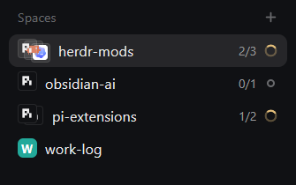

# Spaces Agent Status

Show each space's agent icons, working/total count, and status ring in the
Spaces sidebar. The separate Agents panel stays unchanged.



## Install with a coding agent

```text
Read ~/.config/herdr-app/AGENTS.md, then add this mod: https://github.com/narumiruna/herdr-mods/tree/main/mods/spaces-agent-status
```

## Install in Herdr

With Herdr stopped, copy or link this directory to
`~/.config/herdr-app/mods/spaces-agent-status/`. In a personal layout, set
the Spaces block's `content.mod` to `spaces-agent-status`, then reopen Herdr.
Keep the existing Agents block and keybindings.

See the [recipe](RECIPE.md) for the preview, migration steps, and sharing checks.
